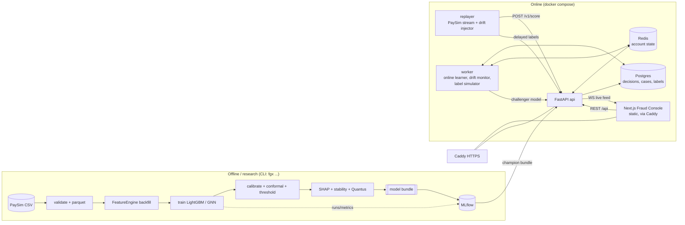
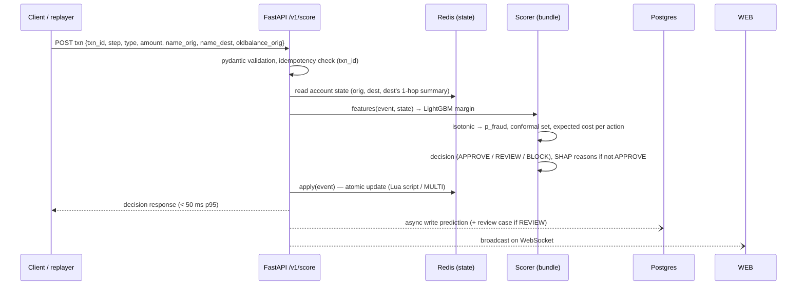

# FraudGraph · Build Plan & Architecture

> **Purpose of this file.** This is the plan we build from and keep up to date. Start every work
> session by reading the **Status tracker**. Pick the next open task, follow its steps, and tick
> it off when its *Done when* checks pass. Update this file in the same commit as the code.

**Project in one line:** FraudGraph is a real-time fraud detection system for payment transactions.
It scores each transaction, says why, says when it is unsure (and routes it to a human), learns
from new labels as a stream, notices when fraud patterns change, and runs as a tested, containerised
service with an analyst console on top.

**What makes it a flagship (not a notebook):**

| Requirement | How FraudGraph covers it |
|---|---|
| 1. Modeling + graph | LightGBM baseline vs. **leak-free temporal graph features** (hand-built) vs. **PyTorch Geometric GNN**. Comparison rule is fixed *before* running it, and the result is reported honestly either way. |
| 2. Imbalance & cost | PR curves, average precision, recall@precision, **money-based cost model**, a cost-optimal threshold **and** a per-transaction expected-cost decision, time-based splits with a label-delay embargo. |
| 3. Uncertainty | **MAPIE** split conformal, class-conditional (Mondrian) → `{legit}`, `{fraud}`, `{legit,fraud}` = *"uncertain, send to manual review"*. |
| 4. Explainability | **SHAP** TreeExplainer → reason codes per transaction. Stability checks (seed, perturbation, background data) and **Quantus** metrics (robustness, faithfulness, randomisation). |
| 5. Online learning & drift | **river** models on a replayed stream with delayed labels. Injected drift scenarios, an own **PSI/KS monitor** plus **Evidently** reports, ADWIN alarms, and a retraining policy. |
| 6. Serving | **FastAPI**, Redis online feature state, Postgres decision log, **Docker Compose**, pytest suite, **deepchecks** validation gates, **GitHub Actions** CI, plus a **Next.js analyst console**. |

---

## Contents

- [Status tracker](#status-tracker)
  - [Plan revisions](#plan-revisions)
- [Part A — Architecture](#part-a--architecture)
  - [A1. Key design decisions](#a1-key-design-decisions)
  - [A2. System overview](#a2-system-overview)
  - [A3. Offline (research) pipeline](#a3-offline-research-pipeline)
  - [A4. Online request path](#a4-online-request-path)
  - [A5. The feature engine (heart of the system)](#a5-the-feature-engine-heart-of-the-system)
  - [A6. Decision policy](#a6-decision-policy)
  - [A7. API contract](#a7-api-contract)
  - [A8. Data model (Postgres)](#a8-data-model-postgres)
  - [A9. Frontend — Fraud Console](#a9-frontend--fraud-console)
  - [A10. Repository layout](#a10-repository-layout)
  - [A11. Tech stack & versions](#a11-tech-stack--versions)
- [Part B — Phased execution plan](#part-b--phased-execution-plan)
  - [Phase 0 — Foundations & data](#phase-0--foundations--data)
  - [Phase 1 — Baseline, evaluation harness & cost](#phase-1--baseline-evaluation-harness--cost)
  - [Phase 2 — Walking skeleton (end-to-end, thin)](#phase-2--walking-skeleton-end-to-end-thin)
  - [Phase 3 — Graph features & GNN study](#phase-3--graph-features--gnn-study)
  - [Phase 4 — Uncertainty & decision policy](#phase-4--uncertainty--decision-policy)
  - [Phase 5 — Explainability & explanation quality](#phase-5--explainability--explanation-quality)
  - [Phase 6 — Streaming, online learning & drift](#phase-6--streaming-online-learning--drift)
  - [Phase 7 — Production backend](#phase-7--production-backend)
  - [Phase 8 — Frontend: Fraud Console](#phase-8--frontend-fraud-console)
  - [Phase 9 — Validation gates, CI/CD & deployment](#phase-9--validation-gates-cicd--deployment)
  - [Phase 10 — Write-up & polish](#phase-10--write-up--polish)
  - [Stretch goals](#stretch-goals)
- [Part C — Testing strategy](#part-c--testing-strategy)
- [Part D — Risks & mitigations](#part-d--risks--mitigations)
- [Part E — Effort, order & parallel work](#part-e--effort-order--parallel-work)
- [Glossary](#glossary)

---

## Status tracker

Legend: ☐ open · ◐ in progress · ☑ done (add date + key metric when ticking)

| ID | Task | Status |
|---|---|---|
| **0.1** | Repo skeleton, tooling (uv, ruff, mypy, pre-commit, poe tasks) | ☑ 2026-10-21 · `poe check` green (10 tests, mypy strict) |
| **0.2** | Data download with checksum + pandera schema | ☑ 2026-10-21 · hash pinned; 6,362,620 rows / 8,213 fraud pass the schema |
| **0.3** | EDA + leakage audit (`docs/data_audit.md`) | ☑ 2026-10-21 · `amount == oldbalance_orig` alone AP 0.981; 5 plan changes applied |
| **0.4** | Synthetic PaySim-schema fixture generator (for tests/CI) | ☑ 2026-10-21 · 20,052 rows, golden sha256 pinned; ring burst in-degree 12 vs ≤ 6 legit |
| **0.5** | CI skeleton (lint + unit tests) | ◐ workflow written, passes locally; waiting for first push |
| **1.1** | Time-based splits with label-delay embargo | ☐ |
| **1.2** | Decision-time tabular features | ☐ |
| **1.3** | Baselines: rule, logistic regression, LightGBM | ☐ |
| **1.4** | Evaluation harness (PR-AUC, recall@P, block bootstrap CIs) | ☐ |
| **1.5** | Cost model, calibration, cost-optimal threshold | ☐ |
| **1.6** | MLflow tracking + model bundle format | ☐ |
| **2.1** | `Scorer` (pure-Python inference) + artifact bundle loader | ☐ |
| **2.2** | FastAPI `/v1/score`, `/health`, `/ready` | ☐ |
| **2.3** | Dockerfile + compose (api only) + smoke test in CI | ☐ |
| **2.4** | Minimal web page that calls `/v1/score` | ☐ |
| **3.0** | Pre-register the graph comparison rule (in this file) | ☐ |
| **3.1** | Temporal feature engine (account state, incremental) | ☐ |
| **3.2** | Hand-built graph features G1 (1-hop + 2-hop, windows) | ☐ |
| **3.3** | Batch/online parity + leakage property tests | ☐ |
| **3.4** | PyG graph build + temporal GraphSAGE/GINE edge classifier | ☐ |
| **3.5** | Hybrid: GNN embeddings → LightGBM | ☐ |
| **3.6** | Experiment matrix (3 seeds) + honest verdict (`docs/graph_study.md`) | ☐ |
| **4.1** | MAPIE split conformal (marginal + class-conditional) | ☐ |
| **4.2** | Three-way decision policy + review capacity | ☐ |
| **4.3** | Coverage over time + review-load analysis | ☐ |
| **5.1** | SHAP TreeExplainer + grouped reason codes | ☐ |
| **5.2** | Stability: seed, perturbation, background sensitivity | ☐ |
| **5.3** | Quantus: robustness, faithfulness, randomisation | ☐ |
| **6.1** | Stream replayer with delayed labels | ☐ |
| **6.2** | Drift scenario library (D0–D5) | ☐ |
| **6.3** | river online models + prequential evaluation | ☐ |
| **6.4** | Own PSI/KS/χ² monitor + ADWIN performance monitor | ☐ |
| **6.5** | Evidently reports | ☐ |
| **6.6** | Retraining policy experiment (static vs online vs triggered) | ☐ |
| **7.1** | Redis-backed feature state | ☐ |
| **7.2** | Postgres decision log, review cases, labels (SQLAlchemy + Alembic) | ☐ |
| **7.3** | Full API: batch, explain, cases, labels, monitoring, models, WebSocket | ☐ |
| **7.4** | Worker: online learner, drift monitor, label simulator | ☐ |
| **7.5** | Champion/challenger shadow scoring + promotion | ☐ |
| **7.6** | Observability: structured logs, Prometheus metrics, latency budget | ☐ |
| **7.7** | Security: API keys, rate limits, CORS, input limits | ☐ |
| **8.1** | Web app scaffold, design system, typed API client | ☐ |
| **8.2** | Live Monitor page | ☐ |
| **8.3** | Review Queue + Case view (SHAP, conformal set, ego-graph) | ☐ |
| **8.4** | Model Lab (PR/cost curves, interactive cost sliders, graph verdict) | ☐ |
| **8.5** | Drift & Stream page (scenario injector, PSI heatmap, alarms) | ☐ |
| **8.6** | Explainability Quality + Model Card pages | ☐ |
| **9.1** | deepchecks suites as CI gates | ☐ |
| **9.2** | Model behaviour tests (invariance, directional, floors) | ☐ |
| **9.3** | Full CI: python, web, model-validation, docker smoke, e2e | ☐ |
| **9.4** | Release workflow (GHCR) + production deploy behind Caddy | ☐ |
| **10.1** | README with results, model card, architecture diagram | ☐ |
| **10.2** | Demo script + GIF/video, write-up | ☐ |

### Plan revisions

| Date | Change |
|---|---|
| 2026-10-16 | Review pass before Phase 0: one job per split (`train_val`, `calib_a`, `calib_b`); step-bucketed state instead of per-step staging; 3.0 rule made exact (seed averaging, primary comparison, freeze); GNN hybrid needs out-of-fold, batch-refreshed embeddings; prior-shift check; D0 built from the stable period; LightGBM `pred_contrib` in serving; idempotent Redis writes; static-export routing; effort re-totalled. |
| 2026-10-16 | Native Windows dev: Python 3.12 via uv, `pyproject.toml` + `uv.lock` instead of `requirements*.in`, poe tasks instead of `make`, `.gitattributes` forcing LF, pre-commit hook shim. |
| 2026-10-21 | From the [data audit](docs/data_audit.md): D2 now excludes the sender balance too; model splits inside steps 1–408 with 409–743 as late-period test; G1-a (destination novelty) is the core graph family, O and G1-b expected weak, `cash_out_after_transfer` dropped; hour-of-day ablation required; B-rule = new destination. |

---

# Part A — Architecture

## A1. Key design decisions

Short ADRs (architecture decision records). Change one only by editing it here with a reason.

| # | Decision | Why |
|---|---|---|
| D1 | **PaySim is the primary dataset**, IEEE-CIS is a stretch port. | PaySim has real account→account edges (`nameOrig → nameDest`), an hourly clock (`step`, 744 hours) for time splits and stream replay, a licence that allows reuse, and it is easy to inject drift into. IEEE-CIS has no account IDs (they have to be built from `card1`/`addr1`/`D1` proxies) and its competition rules limit redistribution. |
| D2 | **Only use what is known at decision time, and no balance column at all.** Destination balances, all `newbalance*` columns **and the sender's `oldbalance_orig`** are excluded from the primary feature set (so are `amount / oldbalance_orig` and `drains_account`). *(Revised 2026-10-21 after the 0.3 audit.)* | A bank does not know the receiving account's balances. The sender balance would be known, but in PaySim `amount == oldbalance_orig` holds for 97.8 % of fraud and 0.0 % of legit, so that one flag scores AP 0.981 ([data audit](docs/data_audit.md)) and would make every later comparison meaningless. E5 reports the balance runs, labelled as artifacts, to show the gap. |
| D3 | **One feature engine for both training and serving.** The engine is a stateful `FeatureEngine.features(event)` → `apply(event)` loop. Offline backfill replays history through the same code the API uses. | Training/serving parity and no temporal leakage are guaranteed by construction. A parity test enforces this. |
| D4 | **Score first, then update state.** Features for a transaction only use events from **strictly earlier steps**, plus labels older than the label delay `L`. Writes go straight into step-keyed buckets; reads skip every bucket with `step ≥ event.step`. | PaySim's `step` is one hour and the order inside an hour is unknown. Labels (chargebacks, analyst verdicts) arrive late in real life. Step-keyed buckets give the same rule offline and online without a "commit the step" event, so several API workers can write at once without races. |
| D5 | **The champion must be servable at p95 < 50 ms on CPU.** GNN results are research results. A GNN only goes to production if it wins by the pre-registered rule **and** fits the latency budget. | Keeps the serving image small (no torch/PyG unless it earns its place). Honest about the engineering cost of graphs. |
| D6 | **Decisions are made in money, not at 0.5.** Calibrated probability × per-transaction cost gives three actions (APPROVE / REVIEW / BLOCK). Conformal uncertainty can only push toward REVIEW. | Matches the brief (a missed fraud costs more than a false alarm) and how fraud operations really work. |
| D7 | **Class-conditional (Mondrian) conformal.** | With 0.1 % fraud, marginal coverage is dominated by the legit class and says nothing about fraud. |
| D8 | **Postgres for decisions/cases/labels, Redis for online feature state, Parquet/DuckDB for offline data, MLflow for experiments and registry.** | Each store does one job. All run in one `docker compose`. In-memory implementations behind the same interfaces keep tests hermetic. |
| D9 | **The frontend is a static Next.js export** served by Caddy. It talks to `/api` (REST) and `/api/ws` (WebSocket). | No Node server in production: one less service to run and secure. The same origin serves UI and API, so no CORS in production. |
| D10 | **CI never needs the real dataset.** A seeded synthetic generator produces PaySim-schema data with planted fraud patterns (including a mule ring). | Hermetic, fast CI. Lets tests assert that graph features *detect* a planted ring. |

## A2. System overview



**Containers:** `caddy`, `api`, `worker`, `replayer`, `redis`, `postgres`, plus `mlflow` (dev profile only).
The web app is a static build copied into the Caddy image.

## A3. Offline (research) pipeline

Every step is a CLI command (Typer), driven by `configs/*.yaml`, logged to MLflow. Notebooks are only
for EDA and are never the source of truth.

```
fgx data download      # Kaggle API → data/raw, verify sha256
fgx data prepare       # pandera-validate → data/processed/paysim.parquet (typed, sorted by step)
fgx features build     # FeatureEngine replay → data/features/{tabular,g1}.parquet
fgx split              # train(+train_val) / calib_a / calib_b / test by step, with embargo → data/splits.json
fgx train --model lgbm --features tabular|tabular+g1|tabular+gnn
fgx gnn train          # PyG temporal edge classifier, writes out-of-fold embeddings
fgx calibrate          # isotonic on calib_a
fgx conformal          # MAPIE on calib_b → per-class quantiles
fgx threshold          # cost sweep on calib_a → threshold + decision-policy params
fgx explain            # SHAP, reason codes, stability, Quantus → reports/explain/
fgx evaluate           # PR curves, CIs, cost table → reports/eval/
fgx stream run --scenario D3   # offline prequential run with river + monitors
fgx validate           # deepchecks suites → reports/validation/ (non-zero exit on fail)
fgx bundle             # package champion → artifacts/bundles/<version>/
fgx all                # everything above, in order
```

**Model bundle** (`artifacts/bundles/<version>/`). This is the only thing the API loads:

```
manifest.json        # version, git sha, data hash, feature list + order, metrics, created_at
model.txt            # LightGBM booster
calibrator.joblib    # isotonic
conformal.json       # per-class nonconformity quantiles, alpha
policy.json          # cost params, thresholds, review capacity
reason_codes.yaml    # feature → group → human template
shap_background.npy  # background sample for SHAP
feature_spec.json    # windows, label delay, engine version (must match the API's engine)
reference_stats.json # per-feature bins + histograms for PSI (drift reference)
```

## A4. Online request path



Latency budget (p95, single CPU worker): validation 1 ms · Redis read 2 ms · features 2 ms ·
LightGBM 1 ms · calibration + conformal + policy < 1 ms · TreeSHAP 5–10 ms (only when not APPROVE) ·
Redis write 2 ms. **Target < 50 ms, alarm at 100 ms.**

## A5. The feature engine (heart of the system)

`fraudgraph/features/engine.py`:

```python
class FeatureEngine:
    def __init__(self, spec: FeatureSpec, store: StateStore): ...
    def features(self, ev: Event) -> dict[str, float]:   # reads state only, pure
    def apply(self, ev: Event) -> None:                    # mutates state after scoring
    def apply_label(self, txn_id: str, is_fraud: bool, at_step: int) -> None
```

- `StateStore` has two implementations: `InMemoryStore` (backfill, tests) and `RedisStore` (API).
- **Windows** are bucketed by step (1 h, 24 h, 7 d) as ring buffers, so updates are O(1).
- **Within-step rule:** events in the same step do not see each other. Every write lands in the bucket
  for its own step, and `features(ev)` only aggregates buckets with `step < ev.step`. Scalar facts
  (`first_seen_step`, last orig→dest step) are stored with their step and compared the same way, so
  no staging or "step advanced" commit is needed. An event whose step is older than the latest step
  already seen is rejected with a clear error, not silently merged (the replayer sends steps in order).
- **Label rule:** a label affects features only once `current_step ≥ label_step + L` (default `L` = 24).

**Feature families** (all decision-time safe):

| Family | Examples |
|---|---|
| Transaction (T) | `log_amount`, `type` (one-hot), `hour_of_day = step % 24` (simulator-inflated: always ablate), `amount == 10M` cap flag. No balance-derived features (D2). |
| Origin history (O) | count/sum of outgoing txns in 1 h/24 h/7 d, time since last txn, `amount` z-score vs own history, first-time-seen flag. **Expected weak:** only 0.15 % of origins repeat; kept for drift scenarios. |
| Destination 1-hop (G1-a) — **core graph family** | `dest_is_new` (no earlier-step transactions in), earlier in-degree (all time / 24 h / 7 d), distinct senders, total received, account age (steps since first seen), burstiness. Never-seen destinations carry 1.23 % fraud vs 0.09–0.18 % otherwise. (`cash_out_after_transfer` dropped: 0 chains in PaySim.) |
| 2-hop (G1-b) | for the destination's recent senders: mean of *their* out-degree, share of them that are new accounts; known-fraud contact: # neighbours with a confirmed fraud label older than `L`. **Expected weak / deprioritised:** only 1,769 accounts both send and receive, and only 44 destinations get more than one fraud. Mostly useful under D3. |
| Pair (G1-c) | has orig→dest happened before, count of past orig→dest txns |
| GNN (G2) | 32-d edge embedding from the PyG model (offline study, see Phase 3) |

> Expect sparsity: in PaySim almost every `nameOrig` appears once, so origin-side history will be
> mostly empty and destination-side features will carry the graph signal. Phase 0 measures this.

## A6. Decision policy

Calibrated `p = P(fraud | x)`, amount `a`, and costs from `configs/costs.yaml`:

| Action | Cost if legit | Cost if fraud |
|---|---|---|
| APPROVE | 0 | `a` (loss) |
| REVIEW | `c_review` (default 5) | `c_review + (1 − r)·a` (r = analyst catch rate, default 0.9) |
| BLOCK | `c_friction` (default 50, churn/complaint) | `c_block` (default 0) |

1. **Expected-cost rule:** pick the action with the lowest `E[cost] = (1−p)·cost_legit + p·cost_fraud`.
   This is a *per-transaction* threshold that depends on the amount.
2. **Conformal override:** the prediction set at level `1−α` (class-conditional):
   `{legit}` → keep the rule's action · `{fraud}` → at least REVIEW · `{legit, fraud}` or `{}` → **REVIEW** with reason *"model uncertain"*.
3. **Capacity:** if REVIEW volume in the current 24 h window is over `review_capacity`, rank pending
   reviews by `expected savings = E[cost|APPROVE] − E[cost|REVIEW]`. Overflow drops to the
   cheapest non-review action. This is logged so we can measure what the capacity limit costs.

We also report the classic **single global threshold** (sweep `t` on `calib_a`, minimise total
cost) because the brief asks for it. It is the comparison point for the per-transaction rule.

## A7. API contract

Base path `/api`. OpenAPI is generated by FastAPI. TypeScript types are generated from it
(`openapi-typescript`), so the frontend never hand-writes types.

| Method | Path | Purpose | Auth |
|---|---|---|---|
| GET | `/health`, `/ready` | liveness; ready once the bundle and Redis are OK | — |
| POST | `/v1/score` | score one transaction → decision | API key (write) |
| POST | `/v1/score/batch` | up to 1 000 txns | API key |
| GET | `/v1/transactions/{id}` | stored prediction + features + reasons | read |
| GET | `/v1/transactions/{id}/explain` | full SHAP vector, grouped reasons, stability flag | read |
| GET | `/v1/transactions/{id}/graph?hops=2` | ego-graph (nodes, edges, fraud labels) for the UI | read |
| GET | `/v1/cases?status=open&sort=priority` | review queue | read |
| POST | `/v1/cases/{id}/resolve` | analyst verdict → label | API key |
| POST | `/v1/labels` | late labels (chargebacks) | API key |
| GET | `/v1/monitoring/drift?window=24h` | PSI/KS per feature, score drift, alarms | read |
| GET | `/v1/monitoring/performance` | rolling precision/recall from labelled txns, champion vs challenger | read |
| GET | `/v1/monitoring/reports/{id}` | Evidently HTML/JSON | read |
| GET | `/v1/models`, `/v1/models/current` | versions, metrics, model card | read |
| POST | `/v1/models/{version}/promote` | challenger → champion | admin key |
| POST | `/v1/sim/start`, `/v1/sim/stop`, `/v1/sim/scenario` | control replayer + drift injection (demo) | admin key |
| WS | `/ws/live` (public URL `/api/ws/live`) | live stream of decisions + alarms | read |
| GET | `/metrics` | Prometheus — not routed by Caddy, scraped on the internal network only | internal |

**`POST /v1/score` response:**

```json
{
  "txn_id": "T000123",
  "model_version": "lgbm-g1-2026.11.02-a1b2c3",
  "p_fraud": 0.412,
  "prediction_set": ["fraud", "legit"],
  "decision": "REVIEW",
  "decision_reason": "model_uncertain",
  "expected_cost": {"APPROVE": 1830.2, "REVIEW": 188.0, "BLOCK": 29.4},
  "reasons": [
    {"code": "DEST_NEW_SENDERS_BURST", "text": "Receiving account got money from 14 new senders in the last 24 h", "impact": 1.21},
    {"code": "DEST_NEVER_SEEN", "text": "Receiving account has never received money before", "impact": 0.87},
    {"code": "DEST_NEW_ACCOUNT", "text": "Receiving account first seen 3 hours ago", "impact": 0.44}
  ],
  "latency_ms": 18.7
}
```

## A8. Data model (Postgres)

```
transactions   (txn_id PK, step, type, amount, name_orig, name_dest, oldbalance_orig, received_at, scenario)
predictions    (txn_id PK/FK, model_version, p_fraud, set_legit bool, set_fraud bool, decision,
                decision_reason, expected_cost jsonb, features jsonb, reasons jsonb, latency_ms)  -- champion only
shadow_predictions (txn_id, model_version, p_fraud, decision, PK(txn_id, model_version))  -- challengers
labels         (txn_id PK/FK, is_fraud, source[analyst|chargeback|simulator], labelled_at_step)
review_cases   (case_id PK, txn_id FK, priority, status[open|in_review|resolved], assignee,
                verdict, notes, created_at, resolved_at)
drift_windows  (window_id PK, start_step, end_step, feature, psi, ks_stat, ks_p, alarm bool)
alarms         (alarm_id PK, kind[input|prediction|performance], detector, feature, step, details jsonb)
model_versions (version PK, stage[champion|challenger|archived], metrics jsonb, bundle_uri, promoted_at)
```

Indexes on `(step)`, `(decision, step)`, `review_cases(status, priority desc)`. Alembic manages migrations.

## A9. Frontend — Fraud Console

**Stack:** Next.js (App Router, `output: 'export'`) + TypeScript + Tailwind + shadcn/ui ·
TanStack Query (REST) · native WebSocket hook · **ECharts** (PR/cost curves, heatmaps, time series) ·
**Cytoscape.js** (ego-graph) · Vitest + Testing Library · Playwright (e2e).

| Page | Who it's for | Contents |
|---|---|---|
| **Live Monitor** `/` | demo / ops | throughput, decision mix (APPROVE/REVIEW/BLOCK) over time, live feed table (WS), score histogram, active alarms banner, cost saved vs approve-all |
| **Review Queue** `/cases` | analyst | sortable by expected savings, filters, SLA timers, capacity gauge |
| **Case view** `/cases/view?id=…` | analyst | decision + p_fraud + conformal set chip ("uncertain"), SHAP waterfall, plain-language reasons, 2-hop **ego-graph** (fraud nodes red, new accounts dashed), account timelines, *Fraud / Legit* buttons → `/resolve` |
| **Model Lab** `/lab` | data scientist / reviewer | PR curves (baseline vs +G1 vs +GNN, with CI bands), **cost sliders** (`c_review`, `c_friction`, `r`) that move the threshold and update the cost curve live, confusion at chosen point, **graph verdict card** (win / no-win + CI), conformal coverage vs α per class, review-load vs α |
| **Drift & Stream** `/drift` | ML engineer | **scenario injector** (D0–D5, sudden/gradual), PSI heatmap (feature × time), score drift, ADWIN alarm timeline, static vs online vs retrained model performance, links to Evidently reports |
| **Explanation Quality** `/explain` | reviewer | seed-stability distribution, Quantus scores vs random baseline, perturbation examples |
| **Model Card** `/model` | everyone | data, intended use, metrics, limits, known artifacts (PaySim balance leak), version history, promote button (admin) |

Routing note: a static export (`output: 'export'`) cannot build dynamic segments like `/cases/[id]`
for IDs that only exist at runtime, so detail pages take the ID as a query parameter and read it
client-side.

UX rules: every number has a tooltip that explains it in plain words. Every chart has an empty state
and a loading state. Colour is never the only signal (icons + text for decisions). Works at 1280 px
and down to tablet.

## A10. Repository layout

```
fraudGraphAi/
├─ ROADMAP.md  README.md  LICENSE  pyproject.toml  uv.lock  .python-version  .gitattributes
│                  # pyproject: core deps (api/worker) + `research` extra (torch/PyG/shap plots…)
│                  # + `dev` group; poe tasks. uv.lock pins everything with hashes.
├─ scripts/        install_git_hooks.py  (dev helpers, not part of the package)
├─ configs/        base.yaml  costs.yaml  features.yaml  drift_scenarios.yaml  conformal.yaml
├─ fraudgraph/
│  ├─ config.py  cli.py  tracking.py  logging.py
│  ├─ data/        download.py  schema.py (pandera)  prepare.py  splits.py  synth.py
│  ├─ features/    engine.py  state.py (InMemory/Redis)  tabular.py  graph_g1.py  spec.py
│  ├─ graph/       build.py (PyG)  models.py (SAGE/GINE)  train.py  embed.py
│  ├─ models/      baselines.py  lgbm.py  calibrate.py  compare.py (bootstrap)  bundle.py
│  ├─ decision/    costs.py  threshold.py  conformal.py  policy.py
│  ├─ explain/     shap_explainer.py  reason_codes.py  stability.py  quantus_eval.py
│  ├─ online/      replay.py  label_delay.py  river_models.py  prequential.py  retrain.py
│  ├─ drift/       scenarios.py  psi_ks.py  detectors.py (ADWIN/PH)  evidently_reports.py
│  ├─ validation/  deepchecks_suites.py  behaviour.py
│  └─ serving/     scorer.py   # pure inference: bundle + engine → Decision (used by api & tests)
├─ services/
│  ├─ api/         main.py  deps.py  schemas.py  db.py  ws.py  routers/{score,cases,labels,monitoring,models,sim}.py
│  ├─ worker/      main.py  jobs/{online_learner,drift_monitor,label_simulator}.py
│  └─ replayer/    main.py
├─ migrations/     (alembic)
├─ web/            Next.js app (app/, components/, lib/api/ generated types, e2e/)
├─ tests/          unit/  integration/  model/  e2e/  conftest.py
├─ notebooks/      01_eda.ipynb  (EDA only)
├─ docs/           data_audit.md  graph_study.md  conformal.md  explain_quality.md  drift_study.md  adr/
├─ reports/        (generated, git-ignored except curated figures)
├─ deploy/         docker-compose.yml  docker-compose.dev.yml  Caddyfile  README.md
├─ docker/         api.Dockerfile  worker.Dockerfile  web.Dockerfile (build → caddy)
└─ .github/workflows/  ci.yml  model-validation.yml  release.yml  full-pipeline.yml
```

## A11. Tech stack & versions

Pin everything in lock files. Check exact versions at Phase 0, and wrap fast-moving libraries so an API
change touches one file.

| Area | Choice | Notes |
|---|---|---|
| Language | Python 3.12 (pinned in `.python-version`, installed by uv) | PyG/river/MAPIE wheels are reliably available |
| Dev platform | Native Windows, macOS or Linux; Docker Desktop for Redis/Postgres/compose | No WSL needed. `uv` + `poe` tasks behave the same everywhere; `.gitattributes` keeps LF so scripts built into Linux images work |
| Data | polars + pyarrow, DuckDB for ad-hoc SQL, pandera schemas | PaySim is ~6.3 M rows / ~470 MB CSV |
| GBM | LightGBM (XGBoost as a sanity check) | |
| Graph | PyTorch (CPU) + PyTorch Geometric; temporal sampling via `NeighborLoader`/`LinkNeighborLoader` `time_attr` | research only (D5) |
| Calibration/conformal | scikit-learn isotonic; **MAPIE ≥ 1.0** (`SplitConformalClassifier`) | MAPIE 1.x API differs from 0.x tutorials |
| Explainability | SHAP (TreeExplainer), **Quantus** | Quantus targets torch/tf models — spike in 5.3 |
| Online/drift | **river** (ARF, Hoeffding Adaptive Tree, LogReg, ADWIN, Page-Hinkley), **Evidently** (≥ 0.7 `Report` API), scipy for KS/χ² | |
| Validation | **deepchecks** tabular (Giskard scan optional) | |
| Tracking | MLflow (local file store / sqlite) | |
| API | FastAPI, pydantic v2, uvicorn, SQLAlchemy 2 + Alembic, redis-py, slowapi, prometheus-client, structlog | |
| Web | Next.js + TS + Tailwind + shadcn/ui, TanStack Query, ECharts, Cytoscape.js | |
| Tests | pytest, hypothesis, pytest-benchmark, schemathesis (optional), Vitest, Playwright, k6/locust | |
| Infra | Docker, docker compose, Caddy, GitHub Actions, GHCR | |

---

# Part B — Phased execution plan

Each task has steps and a **Done when** check. One task = one branch = one PR:
`phase/<id>-<slug>`, e.g. `phase/3.2-g1-features`.

**Git hygiene:** commits and PRs carry only the author's own name: no tool-attribution
trailers or generated-by footers. Local tool and editor folders are excluded through
`.git/info/exclude` (never committed). Local hooks in `.git/hooks` (also never committed) enforce
it: `commit-msg` rejects attribution trailers, `pre-commit` and `pre-push` reject excluded files.
The project `.gitignore` only lists project artifacts (`data/`, `reports/`, `artifacts/`, `.env`, caches).

## Phase 0 — Foundations & data

**Goal:** a clean repo, data you can trust, and a written list of every leak before any modeling.

**0.1 Repo skeleton & tooling**
- `git init`, layout as in A10, `pyproject.toml` (ruff, mypy, pytest config), `.pre-commit-config.yaml`.
- `uv` with `pyproject.toml` + `uv.lock` (hashed). Core deps for api/worker, a `research` extra for heavy research-only libraries, a `dev` group. Add libraries in the task that first needs them.
- Task runner: **poethepoet** tasks in `pyproject.toml`, run as `uv run poe <task>` (cross-platform, no `make`). 0.1 adds `setup`, `lint`, `fmt`, `test`, `check`; `data`/`all` arrive with 0.2 and `up`/`down` with 2.3.
- `pre-commit install` refuses to run when a global `core.hooksPath` is set, so `poe setup` writes a small `.git/hooks/pre-commit` shim instead (`scripts/install_git_hooks.py`).
- `fraudgraph/config.py`: pydantic-settings loading `configs/base.yaml` + `FG_*` env overrides (`FG_CONFIG` picks another file).
- *Done when:* `uv run poe setup && uv run poe check` passes on a clean clone.

**0.2 Data download & schema**
- `fgx data download` uses the Kaggle API (`KAGGLE_USERNAME/KEY` env or `~/.kaggle/kaggle.json`, plain HTTPS, no `kaggle` package) or `--from-file` for a hand-downloaded zip/CSV, verifies sha256 and writes to `data/raw/` (git-ignored). The first download prints the hash; pin it as `data.raw_sha256` in `configs/base.yaml`.
- `fgx data prepare`: pandera schema (types, `type ∈ {...}`, `amount ≥ 0`, `step ∈ [1, 744]`, IDs match `^[CM]\d+$`) → sorted parquet. Columns renamed to snake_case; `txn_id = T{row:07d}` from raw file order; stable sort by step; `paysim.meta.json` records the source hash so an up-to-date run is skipped.
- *Done when:* prepare is idempotent and the schema test fails on a deliberately corrupted sample.

**0.3 EDA + leakage audit** → `docs/data_audit.md`
- Fraud rate overall, by `type`, by step/hour. Volume per step (PaySim volume is very uneven over time — choose split cutoffs from this).
- ID reuse: share of `nameOrig` / `nameDest` seen more than once, degree distributions. **This decides how much graph signal is even possible.**
- Fraud count vs legit volume per step. Public PaySim analyses suggest fraud stays roughly flat per step while legit volume collapses in the late period, so **prevalence differs a lot between splits** — measure it, because calibration and cost decisions depend on it.
- Does a fraudulent TRANSFER's `nameDest` ever reappear as the `nameOrig` of a fraudulent CASH_OUT? This decides whether the `cash_out_after_transfer` feature is worth building.
- Leak list with evidence: `newbalance*` / dest-balance artifacts, `isFlaggedFraud`, the `amount == oldbalanceOrg` pattern, merchant (`M…`) destinations never fraud. Note that `drains_account` is built from the allowed `oldbalance_orig` but rides on the same simulator pattern — report how much of the baseline's AP it carries.
- Show the "everything included" LightGBM score (expected ≈ perfect) as the artifact we refuse to ship.
- *Done when:* the audit lists every column as *allowed / excluded / derived-only*, with a reason.

**0.4 Synthetic fixture** (`fraudgraph/data/synth.py`)
- Seeded generator, ~20 k rows, same schema. Planted patterns: drain-and-transfer fraud, **mule ring** (k new destinations each receiving from many senders in a burst), legit merchant traffic, a daily cycle.
- Mirrors the audit: single-use origins, reused destinations, fraud uniform over the day, sparse late days for legit only, drain fraud mostly to never-seen destinations. Ring transfers do **not** drain the sender, so only graph features can find them. Fraud rate ~1 % (higher than PaySim's 0.13 %) so small-sample tests have enough positives. `fgx data synth` writes it.
- *Done when:* fixture rebuilds byte-identically from its seed, and a test asserts the ring is present.

**0.5 CI skeleton** — `.github/workflows/ci.yml`: `lint` job (ruff, format check, mypy, pre-commit file hygiene) on Ubuntu; `test` job (pytest + coverage report) on Ubuntu **and Windows**; `UV_LOCKED=1` so a stale `uv.lock` fails; uv cache.
- *Done when:* green on the first PR.

## Phase 1 — Baseline, evaluation harness & cost

**Goal:** an honest, strong, non-graph baseline and a harness every later model is judged by.

**1.1 Time-based splits** (`data/splits.py`)
- Split by `step`, **inside the dense period steps 1–408 only** (0.3: legit volume collapses after step 408 while fraud stays flat, so fraud rate jumps 0.18 % → 2.3 %). Start at ~70/15/15 of the dense rows by row count.
- **Each split has one job, so no data is used twice:**

  | Split | Used for |
  |---|---|
  | `train` (last time-fold = `train_val`) | fitting; `train_val` for early stopping, Optuna and the class-weighting choice |
  | `calib_a` (first half of calib by step) | isotonic calibration, global threshold, policy parameters |
  | `calib_b` (second half of calib by step) | conformal quantiles only |
  | `test` | final numbers only, touched once per run |

  Re-using one calib set for early stopping, calibration *and* conformal makes the conformal scores
  depend on the data they are calibrated on, which weakens the coverage guarantee.
- **Embargo:** drop the last `L` steps of each training window (their labels would not be known yet at training time).
- Steps 409–743 are the **late-period test**, reported separately as a natural prevalence shift (never used for fitting, calibration or conformal).
- Record prevalence per split in `splits.json`. Make sure the test window covers enough 24-step days for the block bootstrap (≥ 10 blocks); if not, use 6-step blocks and say so.
- *Done when:* a test asserts `max(train.step) + L < min(calib_a.step)`, `calib_a` and `calib_b` do not overlap, and no `txn_id` is in two splits.

**1.2 Decision-time tabular features** — families T and O from A5, through the `FeatureEngine` (3.1 starts here, without graph families).
- Model only on `TRANSFER` + `CASH_OUT` (the only types with fraud). Other types score as "low risk by rule" but **still update the state** (they are graph edges).

**1.3 Baselines**
- B-rule: `dest_is_new & type ∈ {TRANSFER, CASH_OUT}` (destination never received money at an earlier step). Replaces the old `drains_account` rule, which is a D2 artifact.
- **Hour ablation:** every baseline is also reported without `hour_of_day` (0.3: hour is inflated because legit traffic has a daily cycle and fraud does not).
- B-lr: logistic regression (scaled, class-weighted).
- **B-gbm:** LightGBM with `scale_pos_weight` vs. no weighting + later calibration (pick by `train_val` AP). Early stopping on `train_val`, Optuna (≤ 50 trials) on train-internal time folds. Calib and test are never used for model selection.

**1.4 Evaluation harness** (`models/compare.py`, `fgx evaluate`)
- Metrics: **average precision (PR-AUC)**, recall @ precision ∈ {0.5, 0.8, 0.9}, precision @ top-k alerts/day, $ fraud caught, total cost (A6), savings vs approve-all. ROC-AUC only as a footnote. **No accuracy anywhere.**
- Uncertainty: **block bootstrap by 24-step days** (1 000 resamples) → 95 % CIs. Paired bootstrap for model-vs-model differences.
- Plots: PR curves with CI bands, cost vs threshold, calibration (reliability) curve.
- *Done when:* one command produces `reports/eval/<run>/` (JSON + PNG) for any model, and a golden-number test on the fixture locks the metric code.

**1.5 Cost model, calibration & threshold**
- Isotonic calibration on `calib_a` (Platt as a comparison); report Brier and ECE.
- Global cost-optimal threshold (sweep on `calib_a`, apply to test) **and** per-transaction expected-cost rule (A6). Compare the two on test.
- **Prior shift:** calibrated probabilities assume the calib prevalence. Report test cost with the probabilities as-is *and* after a prior-shift correction to the test-period prevalence (as if it were known from labels), to show how much the expected-cost rule depends on it.
- Sensitivity table: how cost and threshold move when `c_review`, `c_friction`, `r` move ×0.5 / ×2.
- *Done when:* `policy.json` is written and the test-set cost of both rules is reported with CIs.

**1.6 MLflow + bundle** — every run logs params, metrics, the data hash and the git sha. `fgx bundle` writes the A3 bundle.

## Phase 2 — Walking skeleton (end-to-end, thin)

**Goal:** before the deep research phases, prove the whole path works: baseline bundle → API →
container → web page → CI. Everything later plugs into this.

- **2.1** `serving/scorer.py`: loads a bundle, checks `feature_spec.engine_version`, `score(event) -> Decision`. Uses `InMemoryStore` for now.
- **2.2** FastAPI `POST /v1/score`, `/health`, `/ready`, pydantic schemas from A7 (reasons may be empty for now).
- **2.3** `docker/api.Dockerfile` (multi-stage, slim, non-root, healthcheck), `deploy/docker-compose.yml` with `api` only. CI job: build image → run → `curl /ready` → score 3 fixture txns.
- **2.4** `web/`: Next.js scaffold with one page — a form → `/v1/score` → shows the decision.
- *Done when:* `uv run poe up` and opening the page shows a decision for a typed transaction, and CI runs the smoke test.

## Phase 3 — Graph features & GNN study

**Goal:** answer one question with evidence: *do graph features beat the baseline, enough to be
worth serving?*

**3.0 Pre-register the rule** (write it here before running any graph experiment):
> Graph variant **wins** if, over 3 seeds, the paired block-bootstrap 95 % CI of **ΔAP > 0** *and*
> **Δ test cost < 0** (both vs B-gbm on the same split), **and** it meets the latency budget (D5).
> Otherwise we report "no significant gain" with the numbers, and the baseline stays champion.
>
> Details fixed in advance:
> - **Seeds:** average each model's scores over its 3 seeds, then bootstrap the paired difference of
>   the averaged scores. Also report each seed separately; the verdict uses the averaged run.
> - **Primary comparison:** E1 vs E0. E2 and E3 vs E0 are secondary and use a Holm correction.
> - **Cost:** each model uses its own threshold/policy fitted on `calib_a`; Δ cost is on test.
> - **Frozen when:** this block is committed before the first graph result exists. The commit date
>   is the proof. Any later change is a new, dated rule with the reason written next to it.

**3.1 Temporal feature engine** — complete A5: `StateStore` interface, ring-buffer windows, staged
per-step commits, label-delay queue. Backfill over the full 6.3 M events with `InMemoryStore`
(target < 10 min; profile, and use `numba`/array buffers if needed).

**3.2 G1 hand-built graph features** — families G1-a/b/c. Each feature has a docstring that says what
it captures and why it is decision-time safe.

**3.3 Leakage & parity tests** (must pass before any results are trusted):
- *Property test (hypothesis):* features for event `e` are unchanged if you append any events with `step ≥ e.step`.
- *Label-delay test:* a label at step `s` does not change any feature before `s + L`.
- *Parity test:* backfill features == API features (via `RedisStore`) for 2 000 fixture events, exact match.
- *Planted-ring test:* on the fixture, ring destinations have a higher `dest_distinct_senders_24h` than legit ones.

**3.4 PyG GNN** (`graph/`)
- Graph: nodes = accounts (feature: is_merchant, first_seen_step), edges = transactions (log amount, type, hour) with `time` attribute. Task: **edge classification**.
- Model: 2-layer GraphSAGE and GINE (uses edge features). Edge head = MLP([h_src ‖ h_dst ‖ e]). Loss: weighted BCE or focal.
- **Temporal correctness:** `LinkNeighborLoader` with `edge_label_time` + `time_attr` so each target edge only samples strictly earlier edges. Train on the train window. Calib/test edges sample from the full past. Unseen accounts get cold-start embeddings (count how many).
- CPU-friendly: subsample legit edges for training (keep all fraud), cap the fan-out (e.g. [15, 10]).

**3.5 Hybrid** — export the GNN edge embedding (32-d) → append to LightGBM features (B-gbm+G2). This is
often the strongest way to use a GNN, but two traps must be handled:
- **Stacking leak:** embeddings for *training* rows must be out-of-fold (GNN trained on earlier time
  folds, embedding later ones). Embeddings from a GNN that saw those rows' labels make E2 look far too good.
- **Servability:** online, there is no time to run neighbour sampling per request. The servable form
  is per-account node embeddings recomputed in batch (e.g. daily), looked up from Redis, with
  cold-start vectors for new accounts. E2 must be evaluated with **that** staleness (embeddings only
  from data before the last refresh), or its offline number will not match production.

**3.6 Experiment matrix & verdict** → `docs/graph_study.md`

| Run | Features | Model |
|---|---|---|
| E0 | T+O | LightGBM (baseline) |
| E1 | T+O+G1 | LightGBM |
| E2 | T+O+G1+G2 | LightGBM |
| E3 | edge features only | GNN end-to-end |
| E4 | E1 on drift scenario D3 (mule ring) | LightGBM — *where graphs should matter* |
| E5a | E0 + sender balance (`oldbalance_orig`, `drains_account`, `amount == oldbalance_orig`) | LightGBM — artifact reference only |
| E5b | E0 + all balance columns | LightGBM — artifact reference only |

For each run: AP, cost, recall@P0.8, CIs, p95 latency, feature-group SHAP importance. Ablation: drop each
G1 sub-family. **Write the verdict first, in one sentence, then the evidence.** If the graph does not win
on plain PaySim (quite possible given the origin-ID sparsity), say so and show E4 as the case where it does or doesn't. Report E0–E2 with and without `hour_of_day`.

## Phase 4 — Uncertainty & decision policy

**Goal:** the system can say *"I'm not sure — a human should look"*, with a coverage guarantee we can check.

**4.1 MAPIE conformal** (`decision/conformal.py`)
- Fit on train, conformalise on **`calib_b`** (never test, never the data used for isotonic). Score: LAC; compare with APS.
- Check the fraud count in `calib_b`: class-conditional quantiles at level α need at least `1/α − 1` fraud examples (99 at α = 0.01). On the fixture use α ≥ 0.1 or plant enough fraud.
- Useful property: class-conditional coverage survives a pure prevalence (label) shift, which PaySim has between periods; it does not survive a change inside a class (D1, D3).
- Marginal *and* **class-conditional** (Mondrian) coverage at α ∈ {0.01, 0.05, 0.1}. If the pinned MAPIE version lacks Mondrian support, implement per-class quantiles (~30 lines) and check them against MAPIE on the marginal case.
- Store per-class quantiles in `conformal.json`. At serve time the set is computed with no MAPIE import (keeps the serving image slim).

**4.2 Policy** — implement A6 (`decision/policy.py`): expected-cost action → conformal override → capacity.
Unit-test every branch, including the empty set.

**4.3 Analysis** → `docs/conformal.md`
- Empirical coverage per class on test, **per day** (exchangeability breaks under drift — show it).
- Review load vs α; cost of the full policy vs cost-rule-only vs global threshold.
- "Uncertain" cases: what fraction are actually fraud? (They should be much riskier than APPROVE and much less certain than BLOCK.)
- *Done when:* fraud-class coverage on test is within ±2 pp of `1−α` on the stable period, and the deviation under drift is documented.

## Phase 5 — Explainability & explanation quality

**Goal:** per-transaction reasons a human can act on, plus evidence the reasons are stable and faithful.

**5.1 SHAP + reason codes**
- `TreeExplainer` on the LightGBM margin (log-odds; isotonic is monotone, so ranking is kept).
- **In the API, use LightGBM's own `predict(..., pred_contrib=True)`** (same TreeSHAP values) so the serving image does not need `shap`. A test checks it matches `shap.TreeExplainer` to 1e-6.
- **Grouped attributions:** sum SHAP over feature groups (e.g. all `dest_*_24h` → "Receiving account activity") so reasons are not three variants of one idea.
- `reason_codes.yaml`: group → code → template with filled-in values ("…14 new senders in 24 h").
- Global views: mean |SHAP| by group, dependence plots for the top 5.

**5.2 Stability** (`explain/stability.py`)
- **Seed/bootstrap stability:** 5 models (different seeds + bootstrap samples). Per flagged txn: Jaccard of top-3 groups, Kendall τ of group ranks. Target: median Jaccard ≥ 0.8 on BLOCK/REVIEW txns.
- **Input perturbation:** small noise scaled to each feature's std (categoricals fixed). Measure attribution change vs prediction change.
- **Background sensitivity:** re-run with 3 different background samples (interventional SHAP).
- Flag unstable explanations in the API (`explanation_stable: false`), so the UI can show a warning.

**5.3 Quantus** (`explain/quantus_eval.py`)
- **Spike first (½ day):** Quantus is built around torch/tf models. Wrap LightGBM in a thin `torch.nn.Module` whose `forward` calls `predict` (no gradients needed for the metrics below), pass SHAP as `explain_func`.
- Metrics: **Robustness** — `MaxSensitivity`, `LocalLipschitzEstimate`; **Faithfulness** — `FaithfulnessCorrelation`, `MonotonicityCorrelation`; **Randomisation** — `RandomLogit` + our own model-randomisation check (attributions from a label-shuffled model must differ).
- Always compare against baselines: random attributions and permutation importance. SHAP must clearly beat random.
- **Fallback** if the spike fails: implement Max-Sensitivity, faithfulness correlation and rank stability ourselves (~150 lines) and note it in the docs.
- → `docs/explain_quality.md`. *Done when:* a table of SHAP vs random vs permutation on all metrics, with CIs.

## Phase 6 — Streaming, online learning & drift

**Goal:** show the system working over time: it keeps learning, notices when fraud changes, and recovers.

**6.1 Replayer** (`online/replay.py`, also `services/replayer`)
- Streams the test period in step order at a set speed (e.g. 1 step = 2 s in demo mode, unlimited in offline mode).
- **Delayed labels:** fraud labels released after `L` steps (± jitter); a fraction never arrives (missing chargebacks). Legit labels are implicit after `L_legit`.
- Same code runs in-process (offline experiments) and as a service (posting to the API).

**6.2 Drift scenarios** (`drift/scenarios.py`, `configs/drift_scenarios.yaml`)
Composable transforms with a start step, a mode (`sudden` | `gradual` ramp) and a seed. The injection
point is known, so detection delay can be measured. Transforms act on **raw events before the
FeatureEngine**, so features see the drift the way production would. Keep raw fields consistent
(e.g. D4 scales `oldbalance_orig` with `amount`); D3 creates new accounts, events *and* their labels.

| ID | Scenario | Type | Expected detector |
|---|---|---|---|
| D0 | none (null stream) | — | no alarms (measures the false-alarm rate) |
| D1 | small-ticket fraud: fraud amounts shrink below the legit p90 | concept drift | performance (ADWIN), maybe score PSI |
| D2 | channel shift: fraud mix moves TRANSFER → CASH_OUT | concept + covariate | input χ² on `type`, performance |
| D3 | **mule ring**: new destination accounts receive from many senders in bursts | new pattern | graph features + performance |
| D4 | benign inflation: legit amounts +30 % | covariate only | input PSI fires, performance stable (*drift ≠ damage*) |
| D5 | volume surge ×3 | covariate | input + prediction drift, capacity pressure |

**6.3 river online models** (`online/river_models.py`)
- Candidates: `LogisticRegression` + `StandardScaler`; `ARFClassifier` (ADWIN built in); `HoeffdingAdaptiveTreeClassifier`. Handle imbalance with `river.imblearn.RandomUnderSampler` / class weights. Inputs are the same FeatureEngine features as the batch models.
- **Prequential (test-then-train) with delay**, using `evaluate.progressive_val_score(..., delay=...)` or our replay loop. Same metrics as Phase 1 on rolling windows.

**6.4 Own monitor** (`drift/psi_ks.py`, `drift/detectors.py`)
- **Input drift:** PSI per feature (bins fixed from `reference_stats.json`), KS for continuous, χ² for categorical, Benjamini–Hochberg across features. Default alarm: PSI > 0.2 (warn > 0.1).
- **Prediction drift:** PSI of the score distribution, alert-rate z-score.
- **Performance drift:** ADWIN / Page-Hinkley on the error stream of labelled txns.
- **Tune thresholds on D0** to a target false-alarm rate (e.g. ≤ 1 per simulated week). Careful: PaySim's
  own late period already drifts (volume and prevalence), so a D0 replay of the raw test period is *not*
  a null stream. Build D0 from the stable period only (or a within-day shuffle of it), and report the
  natural late-period shift separately — do not tune the detectors until they stop seeing it.
- Unit tests: PSI and KS against hand-computed values; PSI = 0 for identical inputs.

**6.5 Evidently** — daily `Report` (data drift + classification metrics) saved as HTML/JSON, cross-checked against our own PSI numbers (should broadly agree; document differences in binning).

**6.6 Retraining policy experiment** → `docs/drift_study.md`
Compare on each scenario: **(a)** static LightGBM · **(b)** river online · **(c)** LightGBM retrained on a
sliding window every N steps · **(d)** LightGBM retrained when an alarm fires · **(e)** champion + river
challenger in shadow.
Report: detection delay, false alarms, rolling AP/cost, time-to-recover, compute cost.
*Done when:* a results table across D0–D5 × (a–e) and one recommended policy, which is then what the worker does.

## Phase 7 — Production backend

**Goal:** turn the skeleton into the full service from A2/A4/A7.

- **7.1 Redis state** — `RedisStore` with hashes per account and step-bucket keys, atomic update by Lua script, TTL on old buckets. The script first sets a `seen:{txn_id}` marker (`SET NX`, with TTL) and does nothing if it already exists, so a retried request never double-counts. Parity test (3.3) runs against a real Redis in CI (service container).
- **7.2 Postgres** — SQLAlchemy 2 models (A8), Alembic migrations, async writes (background task / queue) so scoring latency does not wait on the DB. Idempotent on `txn_id`.
- **7.3 Full API** — every route in A7. Pagination, filters, consistent error model (`{"error": {"code", "message"}}`), OpenAPI tags and examples.
- **7.4 Worker** (`services/worker`) — scheduled jobs: online learner consumes labels → updates the river challenger; drift monitor computes windows every N steps → `drift_windows`, `alarms`, Evidently reports; label simulator (demo mode) releases labels from the replayer with delay; retraining policy from 6.6.
- **7.5 Champion/challenger** — challenger scores in shadow (`shadow_predictions`), with a performance comparison endpoint. `POST /promote` swaps the bundle atomically (hot reload, no downtime) and records the version.
- **7.6 Observability** — structlog JSON logs with `txn_id`/`model_version`; Prometheus: request latency histogram, decisions by type, review queue size, drift alarms, model version gauge. Load test (k6/locust): p95 < 50 ms at 200 rps on 2 workers.
- **7.7 Security** — API keys (read / write / admin scopes, hashed in env), slowapi rate limits, strict CORS, request size limits, no PII in logs beyond account IDs, secrets only via `.env`.
- *Done when:* `docker compose up` brings up the full stack, the replayer drives traffic, cases appear,
  resolving a case creates a label, the worker raises an alarm under D3, and every test is green.

## Phase 8 — Frontend: Fraud Console

Build against the OpenAPI contract. Use MSW (Mock Service Worker) mocks so UI work can start as soon as 7.3's schemas exist.

- **8.1 Scaffold** — Next.js + TS + Tailwind + shadcn/ui, light/dark theme, layout with side nav, `lib/api` generated types + TanStack Query hooks, `useLiveFeed` WebSocket hook with reconnect/backoff, error boundary, toast system.
- **8.2 Live Monitor** — KPI tiles, decision-mix stacked area, live table (virtualised), alarm banner.
- **8.3 Review Queue + Case view** — the most important screen. SHAP waterfall (ECharts), reason list, conformal chip, Cytoscape ego-graph (2 hops, layout `cose`, click a node → its timeline), keyboard shortcuts (`F` fraud / `L` legit / `J/K` next/prev).
- **8.4 Model Lab** — precomputed curves from `reports/eval` served by `/v1/models/current`; cost sliders recompute the cost curve **client-side** from the stored `(p, amount, label)` test sample, so it feels instant.
- **8.5 Drift & Stream** — scenario control (admin), PSI heatmap, alarm timeline with injection markers, policy comparison chart.
- **8.6 Explanation Quality + Model Card**.
- **Tests:** Vitest for hooks/formatters, Playwright e2e: *start sim → case appears → resolve → label count increments*.
- *Done when:* Lighthouse ≥ 90 for accessibility, every page has loading/empty/error states, and the e2e test passes in CI.

## Phase 9 — Validation gates, CI/CD & deployment

**9.1 deepchecks** (`validation/deepchecks_suites.py`) — `data_integrity`, `train_test_validation`
(feature drift, label drift, new categories) and `model_evaluation` (weak segments by `type` / amount
bucket, calibration), each with explicit **conditions**. `fgx validate` exits non-zero on any failed
condition. Runs on the fixture in CI and on full data in the full-pipeline workflow. HTML reports are uploaded as artifacts.

**9.2 Behaviour tests** (`tests/model/`)
- *Invariance:* renaming account IDs (consistently, keeping the `C`/`M` prefix) does not change scores.
- *Directional:* with everything else fixed, a never-seen destination does not lower risk; a known-fraud neighbour does not lower risk.
- *Minimum functionality:* planted fixture fraud patterns are flagged.
- *Floors:* AP on fixture test ≥ recorded floor; new model AP ≥ champion − tolerance (no silent regressions).
- *Conformal:* fixture class-conditional coverage within tolerance of `1−α`.

**9.3 CI** (`.github/workflows/ci.yml`, on PR + push)

```
python-lint      ruff, ruff format --check, mypy (typed core)
python-test      pytest unit + integration (services: redis, postgres) + coverage ≥ 80 % on fraudgraph/
model-validation fgx all --fixture → deepchecks + behaviour tests + bundle
web              pnpm lint, tsc --noEmit, vitest, next build
docker-smoke     build api/worker/web images → compose up → /ready → score → resolve case
e2e              Playwright against the compose stack (main branch + nightly)
```

Also: `full-pipeline.yml` (manual dispatch: Kaggle secrets → full run → reports as artifacts),
`release.yml` (on tag `v*`: build + push to GHCR, attach model card).

**9.4 Deploy** — VPS with docker compose + Caddy (automatic HTTPS) on FraudGraph's own domain
(to be decided). Public demo mode: read-only keys in the browser, simulator controls behind the admin key, rate
limits on. Backup the Postgres volume. `deploy/README.md` gives the runbook (deploy, rollback to the previous image tag, rotate keys).

## Phase 10 — Write-up & polish

- **10.1 README:** one-paragraph pitch, architecture diagram, **results table** (baseline vs graph with CIs and the verdict), cost savings, conformal coverage, drift study headline, "how to reproduce in 3 commands", limitations (simulated data, the PaySim balance artifact, ID sparsity). Model card in `docs/model_card.md`.
- **10.2 Demo:** a 2-minute script — live monitor → inject D3 → alarms fire → open an uncertain case → SHAP + ego-graph → resolve → challenger catches up → promote. Record a GIF/video. Optional blog post: *"Did the graph help? An honest answer."*

## Stretch goals

- **IEEE-CIS port:** build entities (card/address/email/device) → heterogeneous transaction–entity graph (`HeteroData`); reuse the harness to test whether the graph verdict generalises.
- **Temporal GNN** (TGN / TGAT via PyG) vs the hand-built temporal features.
- **Adaptive conformal inference** (ACI) to keep coverage under drift.
- **Kafka/Redpanda** instead of HTTP replay; **Feast** feature store.
- **Counterfactual explanations** for blocked transactions ("would have passed if …").

---

# Part C — Testing strategy

| Layer | What | Where |
|---|---|---|
| Unit | feature functions, ring buffers, cost math, policy branches, conformal quantiles, PSI/KS vs hand values, reason-code templating | `tests/unit` |
| Property | temporal leakage invariance, label-delay, PSI symmetry/zero | `tests/unit` (hypothesis) |
| Parity | backfill vs `RedisStore` API features (exact) | `tests/integration` |
| Integration | API routes with real Redis/Postgres (CI service containers), bundle hot reload, idempotency | `tests/integration` |
| Model | deepchecks conditions, behaviour tests, metric floors, conformal coverage | `tests/model` |
| Contract | OpenAPI schema snapshot; optional schemathesis fuzzing | `tests/integration` |
| Performance | pytest-benchmark on `Scorer.score`; k6 load test (manual / nightly) | `tests/perf` |
| Frontend | Vitest units, Playwright e2e on compose | `web/` |

Rules: tests never touch the real dataset, every random thing is seeded, and a bug fix comes with a test that reproduces it.

---

# Part D — Risks & mitigations

| Risk | Impact | Mitigation |
|---|---|---|
| PaySim is "too easy" through the balance columns | Fake-looking results | D2 (revised): no balance column in the primary features, sender balance included. Balance runs shown only as artifacts (E5a/E5b). |
| Origin IDs almost never repeat → little graph signal | Graph may not win | Pre-registered rule (3.0), destination-side and 2-hop features, D3 scenario, honest verdict. A null result is a valid result. |
| 6.3 M rows on a laptop | Slow iteration | polars, a 10 % time-contiguous dev sample, profile the engine early, cache feature parquet. |
| PyG / torch install on Windows | Lost days | Use the CPU wheels for `torch` + `torch_geometric` only (SAGE/GINE need no compiled extras like `torch-scatter`). If that still fails, run the GNN study in a Docker container. Serving does not need torch (D5). |
| Library API churn (MAPIE 1.x, Evidently ≥ 0.7, Quantus maintenance, Giskard's shift to LLMs) | Broken code / tutorials | Pin versions, one wrapper module per library, a spike before relying on Quantus, own fallbacks for conformal/PSI. |
| Conformal guarantee breaks under drift | Over-confident "certain" decisions | Per-day coverage monitoring, documented, ACI as stretch. |
| Online state diverges between offline and online | Silent skew | D3 design + parity test in CI against a real Redis. |
| Scope creep (it's a big project) | Never finishes | The walking skeleton (Phase 2) makes something shippable early, and each phase ends with a usable increment. |

---

# Part E — Effort, order & parallel work

Rough effort for one person (working days):

| Phase | Days | Depends on |
|---|---|---|
| 0 Foundations & data | 3–4 | — |
| 1 Baseline + harness + cost | 5 | 0 |
| 2 Walking skeleton | 3 | 1 |
| 3 Graph study | 7–9 | 1 (3.1 engine also feeds 2/7) |
| 4 Uncertainty & policy | 3 | 1 |
| 5 Explainability | 4 | 1 |
| 6 Streaming & drift | 6 | 1, 3.1 |
| 7 Production backend | 6 | 2, 4, 5 (and 6 for the worker) |
| 8 Frontend | 8 | 7.3 contract (start with mocks earlier) |
| 9 Validation, CI/CD, deploy | 4 (CI grows from Phase 0) | 7, 8 |
| 10 Write-up | 3 | all |
| **Total** | **≈ 52–55 days** + 20 % buffer ≈ **63–66 days** | ≈ 13 weeks full-time, ≈ 6 months at half-time |

**Critical path:** 0 → 1 → 3.1 → 3.3 → 7.1 → 7.3 → 8 → 9.

**Can run in parallel once Phase 1 is done:** 3 (graph), 4 (conformal), 5 (explainability) and 6.2
(scenario library) touch separate packages (`graph/`, `decision/`, `explain/`, `drift/`). Phase 8 can start
on mocks as soon as the 7.3 schemas are merged.

**Milestones**
- **M1 (end of Phase 2):** a containerised baseline that scores transactions in a browser. CI green.
- **M2 (end of Phases 3–5):** research results written up — graph verdict, conformal, explanation quality.
- **M3 (end of Phases 6–7):** a live system: stream, drift alarms, review loop, online learning.
- **M4 (end of Phases 8–10):** the polished console, deployed, documented, demo recorded.

---

## Glossary

- **AP / PR-AUC** — average precision, the area under the precision–recall curve; the main metric for rare-event detection.
- **Block bootstrap** — resampling whole days (not single rows) so confidence intervals respect time correlation.
- **Embargo** — a gap before a split boundary so training never uses labels that would not exist yet.
- **Conformal prediction** — wraps any model so its prediction *sets* contain the true class with probability ≥ 1−α (under exchangeability).
- **Mondrian / class-conditional** — conformal guarantee holds separately for each class.
- **PSI** — Population Stability Index; how much a distribution moved vs a reference (0.1 warn, 0.2 alarm).
- **ADWIN** — adaptive windowing detector for change in a stream's mean (e.g. error rate).
- **Prequential** — test-then-train evaluation on a stream.
- **Ego-graph** — the neighbourhood (k hops) around one account or transaction.
- **Champion / challenger** — the live model vs a candidate scored in shadow before promotion.
