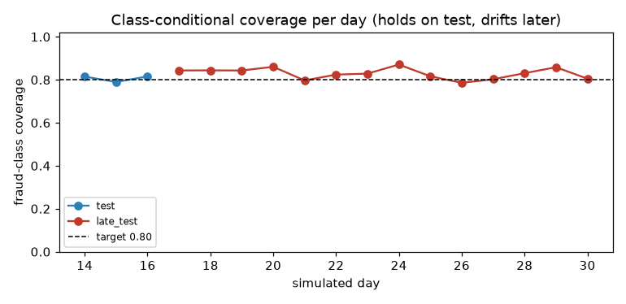

# Uncertainty and the full decision policy

Phase 4. Produced by `uv run fgx conformal` on the graph champion `lgbm_g1` (T+O+G1 minus
the label-dependent G1-b, the winner of the [graph study](graph_study.md)). Full output:
`reports/eval/conformal_lgbm_g1/report.json`; artifacts used by the bundle and API:
`artifacts/policy/lgbm_g1/{calibrator.joblib, conformal.json, policy.json}`.

Calibration (isotonic) is fitted on `calib_a`, conformal quantiles on `calib_b` (192,940 legit,
242 fraud rows), and everything is judged on `test` (steps 356–408, 377,353 rows, 626 fraud)
and the drifted `late_test` (steps 409–743). Costs are in PaySim currency units; for an
Indian deployment read them as ₹ ([policy.md](policy.md) has the scale).

## Verdict

1. **Class-conditional conformal works, marginal conformal does not.** Marginal sets cover
   only **27 %** of fraud at every α (99.8 % of rows are legit, so the guarantee is spent on
   them, D7). Mondrian sets hit the fraud target: **0.805 at α = 0.2** (target 0.80) and
   0.914 at α = 0.1 (target 0.90). Done-when (±2 pp on the stable period): **met**.
2. **The coverage guarantee costs money; it does not save any.** The cheapest policy is the
   expected-cost rule with STEP_UP (59.8 M). Adding the conformal layer costs +11 % in the
   recommended setting (66.3 M) and much more at tighter α. It buys a guarantee: at least 80 %
   of fraud is never in a "legit-only" set, even when the period shifts.
3. **STEP_UP is the biggest single win of this phase** (Juspay track J3): the expected-cost
   rule drops from 71.3 M to **59.8 M** by replacing most human reviews (2.7 % → 0.9 %) with
   cheap OTP / 3DS challenges (6.1 %).
4. **Under drift, fraud coverage holds and legit coverage breaks.** In the late period, fraud
   coverage stays 0.79–0.87 per day (target 0.80) while legit coverage falls to 0.58–0.88:
   class-conditional coverage survives the prevalence shift but not changes inside the
   legit class.

**Recommended (and configured) policy:** Mondrian LAC at **α = 0.2**, uncertain sets →
**STEP_UP**, at most **2,000 human reviews per day** (first-come in serving).

## Policies on test

| Policy | Test cost [95 % CI] | Review | Step-up | Block | Fraud amount touched |
|---|---|---:|---:|---:|---:|
| Global threshold (alert → review) | 153.8 M [117.9, 196.1] | 2.86 % | — | — | 97.5 % |
| Expected cost (3 actions) | 71.3 M [44.8, 96.9] | 2.66 % | — | 0.09 % | 97.2 % |
| **Expected cost + STEP_UP** | **59.8 M [38.6, 83.0]** | 0.89 % | 6.14 % | 0.09 % | 98.3 % |
| + conformal, uncertain → REVIEW | 117.3 M [74.3, 153.1] | 10.16 % | 1.79 % | 0.09 % | 98.4 % |
| + conformal, uncertain → STEP_UP | 71.2 M [46.2, 96.6] | 3.18 % | 8.77 % | 0.09 % | 98.4 % |
| **+ capacity 2,000 reviews/day (first-come)** | **66.3 M [43.1, 91.2]** | 1.34 % | 10.49 % | 0.15 % | 98.4 % |
| + capacity 2,000/day, oracle ranking | 63.9 M [40.7, 86.5] | 1.34 % | 10.52 % | 0.09 % | 98.4 % |

Conformal rows use α = 0.2. "Touched" = the fraud amount that met anything other than
APPROVE. The oracle ranks a day's reviews by expected savings with hindsight; first-come is
what a live queue can do, and loses 2.4 M against it.

### What each action catches (recommended policy)

| Action | Rows | Fraud rate |
|---|---:|---:|
| APPROVE | 332,127 | 0.029 % |
| STEP_UP | 39,595 | 0.35 % |
| REVIEW | 5,054 | 3.4 % |
| BLOCK | 577 | 38.5 % |

Every step up in severity is roughly 10× riskier than the one before, which is what a
cost-based policy should produce.

## Coverage

LAC scores; test unless stated.

| Sets | α | Fraud coverage | Legit coverage | Set shares (legit / fraud / both / empty) | Late fraud coverage |
|---|---:|---:|---:|---|---:|
| marginal | 0.01 | 0.268 | 0.991 | 99.0 / 0 / 0 / 0.9 % | 0.220 |
| marginal | 0.1 | 0.268 | 0.899 | 89.7 / 0 / 0 / 10.2 % | 0.220 |
| Mondrian | 0.01 | 0.994 | 0.991 | 15.0 / 1.0 / 84.1 / 0 % | 1.000 |
| Mondrian | 0.05 | 0.976 | 0.941 | 28.7 / 6.1 / 65.2 / 0 % | 0.998 |
| Mondrian | 0.1 | **0.914** | 0.899 | 66.2 / 10.3 / 23.6 / 0 % | 0.955 |
| **Mondrian** | **0.2** | **0.805** | 0.899 | 89.7 / 3.2 / 0 / 7.0 % | 0.829 |

- **Why the guarantee is expensive:** 5 % of calibration frauds have a calibrated p below
  ~0.0003. Covering 95 % of fraud means including "fraud" in the set of every payment above
  that, i.e. two thirds of traffic becomes "uncertain". At α = 0.2 the two class thresholds
  cross instead: no payment is "both", and 7 % fit neither class ("empty"), which the policy
  also treats as uncertain.
- **α = 0.05 over-covers** (0.976 vs 0.95): the calibration window has more near-zero-score
  frauds than the test window. The guarantee is only as good as exchangeability between them.
- **APS is degenerate for binary non-randomised sets:** every set contains both classes (the
  true class's score is 1 whenever it is not the top class), so APS is reported but unused.
- **Uncertain cases are riskier, but not dramatically:** at α = 0.2, "empty" sets have a fraud
  rate of 0.12 %, 4× the legit-only sets (0.027 %); fraud-only sets are at 4.2 %.

Our class-conditional quantiles are implemented directly (`decision/conformal.py`, no MAPIE
import at serve time). A test checks the marginal LAC sets against MAPIE 1.6's
`SplitConformalClassifier`: they agree on more than 99.9 % of rows.

### Coverage over time

| Day | Fraud | Fraud coverage | Legit coverage |
|---|---:|---:|---:|
| 14 (test) | 54 | 0.815 | 0.803 |
| 15 (test) | 252 | 0.790 | 0.906 |
| 16 (test) | 320 | 0.816 | 0.906 |
| 17–30 (late) | 216–280 per day | 0.79–0.87 | 0.58–0.88 |

## Review load vs α (uncertain → STEP_UP, before capacity)

| α | Uncertain share | Review share | Reviews/day (mean / max) | Test cost |
|---:|---:|---:|---|---:|
| 0.01 | 84.1 % | 1.3 % | 1,687 / 2,489 | 107.2 M |
| 0.05 | 65.2 % | 6.0 % | 7,505 / 10,497 | 123.6 M |
| 0.1 | 23.6 % | 10.2 % | 12,785 / 17,718 | 129.3 M |
| **0.2** | 0 % (+7 % empty) | 3.2 % | 4,002 / 5,861 | **71.2 M** |

The capacity limit of 2,000 reviews/day binds at α = 0.2 (1.8 % of payments overflow to their
cheapest non-review action). A real deployment would set the capacity from team size.

## STEP_UP (Juspay track J3)

| Action | Cost if legit | Cost if fraud |
|---|---|---|
| STEP_UP | `c_step_up` = 200 (OTP / 3DS friction and abandonment) | 200 + (1 − 0.7) · amount |

A challenge stops 70 % of fraud (an analyst review stops 90 %) at a tenth of the review's
cost for a legit customer. For a payment switch this is the natural middle action: the
expected-cost rule only sends a payment to a human when the extra 20 % catch rate is worth
the 2,000 review cost. Settings: `costs.step_up_*` and `policy.*` in `configs/base.yaml`.

## Serving

The bundle carries `conformal.json` (two quantiles) and the policy fields. `POST /v1/score`
returns `prediction_set` (`["legit"]`, `["fraud"]`, both, or `[]`), the action (including
`STEP_UP`) and the reason: `expected_cost`, `conformal_fraud`, `model_uncertain` or
`capacity_overflow`. Capacity is a per-day counter in the API process (it moves to Redis
in 7.1).
