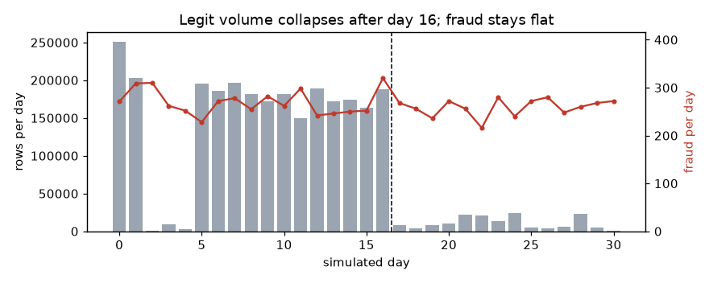
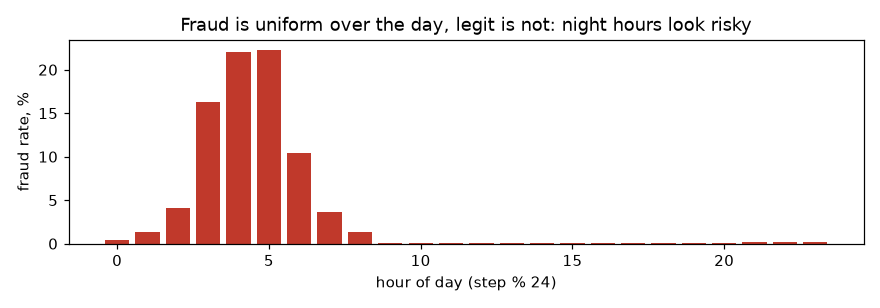
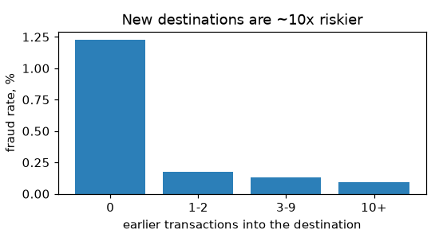

# PaySim data audit

Task 0.3. Every number below comes from `uv run fgx data audit` on the pinned PaySim file
(`sha256 16910f90…ea6b`) and is saved in `reports/audit/audit.json`. Re-running the command
reproduces them exactly (the LightGBM probes run with `deterministic=True`).

## Verdict

1. **The sender balance is a near-perfect simulator artifact.** In TRANSFER + CASH_OUT,
   `amount == oldbalance_orig` holds for **97.8 % of fraud and 0.0 % of legit** transactions.
   That one flag alone scores **AP 0.981**. A model that may see `oldbalance_orig` learns this
   rule, and every later comparison (graph, GNN, explanations) becomes meaningless.
   **Decision: `oldbalance_orig` is excluded from the primary feature set**; the
   sender-balance model is reported only as an artifact reference (see [Decisions](#decisions-for-the-roadmap)).
2. **Without balances the problem is hard but learnable**: amount + type + hour gives
   AP 0.156 at 0.14 % prevalence (≈ 110× random). Adding one decision-time graph fact —
   *has this destination received money before?* — lifts it to 0.180 (test) and 0.426 → 0.543
   (late period). So the destination side carries real signal for the graph study.
3. **Origins never repeat and almost nobody both sends and receives**, so origin-history and
   2-hop features will be close to empty. Graph signal lives on the destination side only.
4. **Time is uneven.** Legit traffic is dense on days 0–1 and 5–16 and collapses afterwards,
   while fraud stays flat at ~265 per day. After step 408 the fraud rate in TRANSFER + CASH_OUT
   jumps from 0.18 % to 2.3 %; the last day (steps 721–743) is 100 % fraud.

## The data

| | |
|---|---|
| Rows | 6,362,620 over steps 1–743 (1 step = 1 hour, 31 days) |
| Fraud | 8,213 (0.129 %) |
| Modelled subset (TRANSFER + CASH_OUT) | 2,770,409 rows, fraud rate 0.296 % |

| Type | Rows | Fraud |
|---|---:|---:|
| CASH_OUT | 2,237,500 | 4,116 |
| PAYMENT | 2,151,495 | 0 |
| CASH_IN | 1,399,284 | 0 |
| TRANSFER | 532,909 | 4,097 |
| DEBIT | 41,432 | 0 |

Fraud occurs only in TRANSFER and CASH_OUT, as the plan assumes (1.2). The other types are
still graph edges.

## Time structure and splits

- Fraud is flat over time (216–320 per day). Total volume is 350k–575k rows per day on days
  0–1 and 5–16, but only 1k–28k on days 2–4 and 0.3k–58k on days 17–30.
- So the fraud rate is a property of *legit volume*, not of fraud: 0.11–0.20 % on dense days,
  1–7 % on sparse days, 72 % on day 2 and 100 % on day 30.
- Row-count quantiles of the modelled subset fall at step 236 (50 %), 323 (70 %), 377 (85 %),
  398 (90 %). A plain 70/15/15 split by rows would put only **44 %** of all fraud in train and
  about half of it in the test set, at a very different prevalence.

| Window | Rows (T + CO) | Fraud | Fraud rate |
|---|---:|---:|---:|
| Dense, steps 1–408 | 2,615,822 | 4,589 | 0.175 % |
| Late, steps 409–743 | 154,587 | 3,624 | 2.344 % |

**Recommendation for 1.1:** draw train / `train_val` / `calib_a` / `calib_b` / test from steps
1–408 only, and keep steps 409–743 as the separate **late-period test** (natural prevalence
shift). The sparse days 2–4 sit inside the training window, which is fine.

**Hour of day is inflated by the same effect.** Legit traffic follows a daily cycle and fraud
does not, so hours 3–5 show fraud rates of 16–22 % against 0.05–0.1 % in the afternoon. A real
bank sees some of this, but here it is mostly the simulator. Keep `hour_of_day` allowed, but
always report an ablation without it.

## Accounts and graph potential

| | `name_orig` | `name_dest` |
|---|---:|---:|
| Distinct accounts | 6,353,307 | 2,722,362 |
| Accounts seen more than once | 0.15 % | 16.9 % |
| Rows whose account repeats | 0.29 % | 64.4 % |
| Most rows for one account | 3 | 113 |

- Only **1,769** accounts ever appear as both sender and receiver, and no origin is a merchant.
- **Origin history (family O) will be almost always empty.** Keep the code (it is cheap and
  needed for drift scenarios), but expect no gain from it.
- **2-hop features (G1-b) have almost nothing to work with**: a destination's senders are
  one-shot accounts, so "their out-degree" is ~1 everywhere. Deprioritise G1-b.
- **The transfer → cash-out chain does not exist in PaySim**: of 4,097 fraudulent transfers,
  **0** destinations later cash out as a fraud origin (8 appear as any origin at all). Drop the
  `cash_out_after_transfer` feature.
- **No natural mule rings**: 8,213 frauds go to 8,169 distinct destinations; only 44 receive
  more than one fraud. Rings appear only in the injected D3 scenario.

**But destination novelty is strong and decision-time safe.** Counting only transactions into
the destination at strictly earlier steps:

| Earlier transactions into the destination | Rows | Fraud rate |
|---|---:|---:|
| 0 (never seen) | 422,646 | 1.23 % |
| 1–2 | 543,990 | 0.18 % |
| 3–9 | 996,660 | 0.13 % |
| 10+ | 807,113 | 0.09 % |

63 % of frauds go to a never-seen destination, versus 15 % of legit transactions. This is the
G1-a family the graph study should focus on.

## Leaks and artifacts

Shares within TRANSFER + CASH_OUT, legit vs fraud:

| Check | Legit | Fraud | Reading |
|---|---:|---:|---|
| `amount == oldbalance_orig` (exactly) | 0.0 % | 97.8 % | fraud always empties the account; legit never does |
| `oldbalance_orig == 0` | 47.4 % | 0.5 % | half of legit senders "have no money" — simulator |
| sender balances don't add up (`old − amount ≠ new`) | 90.5 % | 0.5 % | legit bookkeeping is broken, fraud's is exact |
| receiver balances don't add up | 22.6 % | 56.5 % | post-transaction receiver data, artifact |
| receiver old and new balance both 0 with amount > 0 | 0.06 % | 49.6 % | artifact |
| `amount` exactly 10,000,000 | 0.11 % | 3.5 % | fraud amounts are capped at 10M (max legit 92.4M) |
| `amount == 0` | 0 rows | 16 rows | only fraud has zero-amount rows |

Other columns:
- **`isFlaggedFraud`** fires on 16 rows, all fraudulent TRANSFERs of at least 353,874. Precision
  100 %, recall 0.19 %. It is another system's output, not an input.
- **Merchant destinations (`M…`)** appear only in PAYMENT and are never fraud. `dest_is_merchant`
  is therefore redundant with `type` inside the modelled subset.
- `drains_account = amount ≥ oldbalance_orig` from the plan is *not* the leak: it is true for
  90.1 % of legit (because of the zero balances) and 98.2 % of fraud. The exact equality is.

### How much each column set leaks

Quick LightGBM probe (300 trees, fixed settings). Train steps 1–300, test steps 301–408,
late steps 409–743. Not the Phase 1 baseline: one run, no tuning, no CIs.

| Columns | AP test (prev. 0.14 %) | AP late (prev. 2.34 %) |
|---|---:|---:|
| Single flag `amount == oldbalance_orig` | **0.981** | 0.976 |
| All columns incl. post-transaction balances (leaky) | 0.936 | 0.983 |
| amount, type, hour, `oldbalance_orig` | 0.616 | 0.809 |
| amount, type, `oldbalance_orig` | 0.605 | 0.824 |
| destination balances only (+ amount, type) | 0.370 | 0.545 |
| amount, type, hour + new-destination flag | **0.180** | **0.543** |
| amount, type, hour (no balances) | 0.156 | 0.426 |

Trees learn the exact-equality rule only partly from raw columns (0.605), but given the flag
they get 0.981. Any engineered feature that compares `amount` with `oldbalance_orig` hands the
model the answer.

## Column verdicts

| Raw column | Verdict | Reason |
|---|---|---|
| `step` | derived-only | time order, splits, windows and `hour_of_day`. Hour is inflated by the simulator (always ablate). |
| `type` | allowed | known at authorisation. Model only TRANSFER + CASH_OUT; other types still update graph state. |
| `amount` | allowed | known at authorisation. Mild artifacts (10M cap, zero amounts) noted, kept. |
| `nameOrig` | derived-only | graph key for origin history; almost never repeats. |
| `oldbalanceOrg` | **excluded** | known at decision time in reality, but `amount == oldbalance_orig` is a 97.8 % / 0.0 % simulator artifact (AP 0.981 alone). Used only in a labelled artifact-reference run. |
| `newbalanceOrig` | excluded | post-transaction value; its inconsistency with `old − amount` is itself a 90 % / 0.5 % artifact. |
| `nameDest` | derived-only | graph key: destination history, in-degree, novelty (G1-a). |
| `oldbalanceDest` | excluded | the receiving bank's data (D2); artifact (49.6 % zero-zero for fraud). |
| `newbalanceDest` | excluded | post-transaction value; same artifact. |
| `isFraud` | label | target. Its availability for features is delayed by `L` steps (D4). |
| `isFlaggedFraud` | excluded | output of another rule system; 16 rows, recall 0.19 %. |

## Decisions for the roadmap

Applied to ROADMAP.md on 2026-10-21:

1. **D2:** move `oldbalance_orig` from allowed to excluded for the primary track. Derived
   features `amount / oldbalance_orig` and `drains_account` go with it. Extend E5 (artifact
   reference) with a "sender balance allowed" run so the gap is shown, not hidden.
2. **1.1 splits:** all model splits inside steps 1–408; steps 409–743 are the late-period test.
3. **A5 features:** drop `cash_out_after_transfer`; mark origin history (O) and 2-hop (G1-b) as
   expected-weak; make destination novelty and in-degree (G1-a) the core graph family.
4. **Hour of day:** keep, with a mandatory ablation in 1.3 and 3.6.
5. **B-rule baseline (1.3):** redefine as "destination never seen and type ∈ {TRANSFER, CASH_OUT}"
   instead of `drains_account`.
