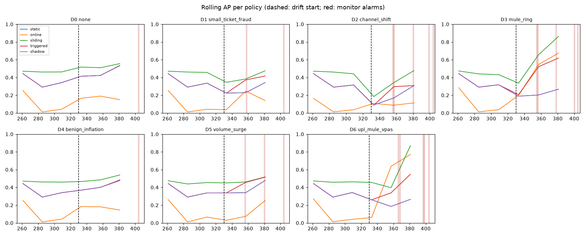
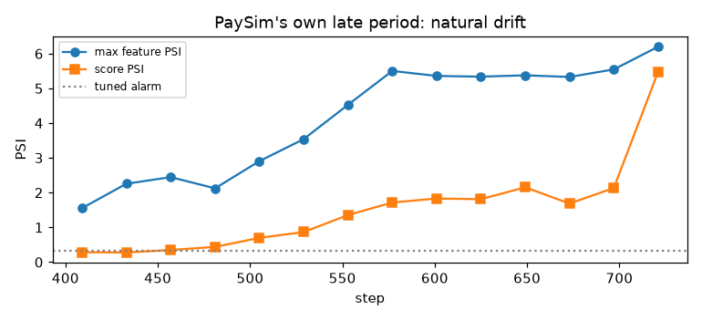

# Drift and retraining study

Phase 6. Produced by `uv run fgx drift-study` (about 55 min on a laptop; `--resume` reuses
finished scenarios from `reports/drift/scenarios/`). Full output: `reports/drift/study.json`,
plots `reports/drift/rolling_ap.png` and `reports/drift/natural_late_psi.png`, Evidently
reports in `reports/drift/evidently/`.

## Set-up

- **Stream:** steps 261–408 (train_val through test) are replayed in order. Each scenario from
  `configs/drift_scenarios.yaml` changes the *raw events* from step 330 on. The features are
  then recomputed by the same engine the API runs.
- **Labels arrive late and incomplete** (`online/replay.py`). A fraud label is known 24 ± 6
  steps after the payment. 10 % of frauds are never reported and look legit once 24 steps have
  passed. Retrains and the online learner only see these *observed* labels. Every result below
  is scored on the true labels.
- **Policies.** All five use the champion `lgbm_g1`'s features and the Phase 4 costs. Each
  policy's scores are calibrated on the steps before the drift starts, and the cost-optimal
  rule is applied after it.
  - (a) **static** — the champion, never retrained.
  - (b) **online** — a river logistic regression with undersampling. It is warm-started on
    train_fit and learns test-then-train from delayed labels.
  - (c) **sliding** — LightGBM retrained every 24 steps on the labels known so far, from the
    last 168 steps.
  - (d) **triggered** — the same retrain, but run only when a monitor alarm fires, with a
    48-step cooldown.
  - (e) **shadow** — the champion serves. The river challenger takes over for a window if it
    beat the champion by > 0.02 AP over the last 72 steps of known labels.
- **Monitors** watch the static model.
  - *Input:* PSI per feature, KS or χ², and Benjamini–Hochberg. An alarm needs a significant
    test *and* PSI above the threshold.
  - *Prediction:* score PSI and an alert-rate z-score.
  - *Performance:* ADWIN and Page-Hinkley on "was this fraud missed?" for each arriving fraud
    label. A miss is a score below the reference 98th percentile.
  - Windows are one full day (24 steps). The reference is the stream's first two days
    (261–308), built on the model matrix.
  - Thresholds are tuned on D0 to at most one false alarm per monitor. This gives input PSI
    0.32, score PSI 0.2, alert z 4, Page-Hinkley 30 and ADWIN δ 0.002.

## Results: AP · cost after the drift starts (steps 330–408)

Lower cost is better; the best cost in each row is bold. Costs are in the Phase 4 units
(c_review 2,000, c_friction 20,000, STEP_UP on).

| Scenario | (a) static | (b) online | (c) sliding | (d) triggered | (e) shadow |
|---|---|---|---|---|---|
| D0 none | 0.443 · 91 M | 0.127 · 231 M | **0.508 · 82 M** | 0.439 · 92 M | 0.443 · 91 M |
| D1 small-ticket fraud | 0.235 · 60 M | 0.111 · 68 M | **0.373 · 51 M** | 0.304 · 55 M | 0.235 · 60 M |
| D2 channel shift (gradual) | 0.190 · 191 M | 0.091 · 225 M | **0.267 · 166 M** | 0.193 · 175 M | 0.190 · 191 M |
| D3 mule ring | 0.216 · 151 M | 0.467 · 299 M | **0.637 · 111 M** | 0.467 · 122 M | 0.216 · 151 M |
| D4 benign inflation | 0.407 · 109 M | 0.125 · 242 M | **0.473 · 105 M** | 0.401 · 111 M | 0.407 · 109 M |
| D5 volume surge ×3 | 0.367 · 150 M | 0.058 · 304 M | **0.452 · 129 M** | 0.414 · 134 M | 0.367 · 150 M |
| D6 UPI mule VPAs (gradual) | 0.223 · 101 M | 0.542 · 264 M | **0.603 · 96 M** | 0.398 · 100 M | 0.223 · 101 M |

Costs are not comparable across rows: D1 shrinks the fraud amounts, and D3, D5 and D6 add
payments.

*The static line is hidden under shadow, which never switched to the challenger.*

**Injected fraud caught** (share in the top 1 % of scores after the start):

| | static | online | sliding | triggered | shadow |
|---|---|---|---|---|---|
| D3 mule rings | 0.17 | 0.75 | 0.71 | 0.53 | 0.17 |
| D6 UPI mule VPAs | 0.16 | 0.78 | 0.65 | 0.35 | 0.16 |

**Time to recover:** the steps until rolling AP is back above 90 % of its pre-drift level.
"—" means it never recovered inside the stream.

| | static | online | sliding | triggered |
|---|---|---|---|---|
| D1 | 51 | 27 | 51 | 27 |
| D2 | — | 0 | 51 | — |
| D3 | — | 0 | 27 | 27 |
| D6 | — | 27 | 51 | 27 |

**Compute per stream** (D0): static 1 s, triggered 2 s (one retrain), sliding 16 s (6
retrains), online 35 s (per-row Python).

## Detection

Detection delay is counted in steps from the drift start (330) to the first alarm window's
end. The no-drift stream D0 has a single alarm: the input monitor at step 404. That is the
one false alarm the tuning allows, and it comes from PaySim's own drift in
`g_dest_in_n_1w` (PSI 0.45). Every scenario shares that window, so an input delay of 74 is
the same natural alarm and not detection.

| Scenario | input | prediction | performance | Detected by |
|---|---|---|---|---|
| D0 none | (74: natural) | — | — | nothing, as it should |
| D1 small-ticket fraud | (74) | — | **28** | labels only |
| D2 channel shift | (74) | **26** (alert rate z 7.2) | **27** | predictions and labels |
| D3 mule ring | (74) | — | **25** | labels only |
| D4 benign inflation | (74) | — | — | nothing: drift, but no damage |
| D5 volume surge | **26** (`g_dest_in_n_1d`, PSI 2.5) | — | — | inputs only: no damage |
| D6 UPI mule VPAs | (74) | — | **36** | labels only |

That is the expected pattern ("drift ≠ damage").

- **Input monitors see only the covariate shift.** Fraud is about 0.2 % of traffic, so a
  change in *fraud* behaviour barely moves any feature's distribution. D1, D3 and D6 are
  invisible to PSI and KS.
- **The label-based monitor catches exactly the damaging scenarios** (D1, D2, D3, D6) about
  one label delay after the start (25–36 steps; labels arrive after 24). It stays quiet on
  D0, D4 and D5.
- The prediction monitor fires on D2 because TRANSFER→CASH_OUT shifts the alert rate. It
  misses everything else.

## Recommended policy

**Retrain the LightGBM champion on a sliding window every day (24 steps, last 168 steps of
known labels). Use the monitors to raise alarms, not to trigger retrains.**

- **Sliding retrain has the lowest cost on all seven scenarios, D0 included.** It never
  loses to static, and it is the best answer to both new mule patterns (D3: AP 0.64 vs 0.22
  static; D6: 0.60 vs 0.22). Part of its edge is simply fresher data: on D0 it also beats
  the static model trained on steps 1–236 (82 M vs 91 M). Six retrains cost 16 s of CPU per
  stream.
- **Alarm-triggered retraining is worse.** The only monitor that sees damage needs labels,
  so it fires one label delay late. It then retrains once (cooldown) and stays on that model.
  It beats static on cost except on D0 and D4, where nothing needed fixing, but sliding beats
  it everywhere.
- **The online river learner ranks new patterns well but is a poor decision model.** It
  catches 75–78 % of injected mules in its top 1 %, the most of any policy, and its AP on D3
  and D6 is about twice static's. But it has the highest cost everywhere (231–304 M).
  - Its scores are calibrated on the pre-drift window, where it is weak (AP 0.02–0.03), so
    the cost rule acts on badly scaled probabilities.
  - It is the slowest policy, at 35 s per stream in pure Python.
- **Shadow switching never triggered.** With labels 24 steps late and a 72-step lookback,
  the challenger never beat the champion by the 0.02-AP margin in time, so (e) equals (a).
  Shadow is still useful as a *report* (7.5): the river challenger's lead on D3 and D6 is
  visible. But as a serving rule at this label delay, it adds nothing over sliding retrains.

What the worker (7.4) should do:
1. Run the daily sliding retrain.
2. Treat Page-Hinkley or ADWIN alarms on missed fraud labels as a page to an analyst ("a
   fraud pattern is beating the model").
3. Show the input and prediction monitors on the ops dashboard as context. They explain
   *what* changed (volume, amounts, payment mix) but do not mean the model is failing.

## Evidently cross-check (6.5)

For D0 and D4, an Evidently `DataDriftPreset(method="psi")` report compares the monitor
reference (5,000 random rows from steps 261–308) with 5,000 random rows after step 330. The
reports are saved as HTML and JSON. Our PSI is then compared with Evidently's per-column PSI
on the same rows.

| | features | Spearman (ours vs Evidently) | both > 0.2 | only ours | only Evidently |
|---|---|---|---|---|---|
| D0 | 24 | 0.85 | 2 | 0 | 0 |
| D4 | 24 | 0.85 | 2 | 0 | 0 |

- **The two agree on what is drifting.** Both flag `g_dest_in_n_1w` and `g_dest_senders_1w`,
  at 0.235 (ours) vs 0.259 (Evidently). That is PaySim's own drift, not the scenario.
- **Values differ only through binning.** Ours uses fixed reference quantile bins with "no
  history" values already filled. Evidently re-bins every comparison from the reference, so
  it reads a little higher on sparse features (`g_dest_in_share_1d`: 0.01 vs 0.06).
- **D4's +30 % legit amounts is a small shift.** In log space that is +0.26, so
  `t_log_amount` reads only 0.08 (ours) and 0.10 (Evidently), under the 0.2 alarm. That is
  why the input monitor leaves D4 alone, and here that is the right call.

## PaySim's own late period (steps 409–743)

The same monitors, with the reference set to steps 261–329, alarm on **every one** of the 14
late-period days. Max feature PSI is 1.6–6.2, mostly on destination-volume features
(`g_dest_in_n_1w`), and score PSI is 0.3–5.5. Prevalence swings between 1 % and 7.5 % per
day, against 0.2 % before step 409. The last window (721+) is 272 payments, all fraud,
which is an artifact of the simulator's tail. This is why the null stream had to come from
the stable period ([data_audit.md](data_audit.md)).

Yet the static model's daily AP stays between 0.31 and 0.63. Here the input monitors
measure the simulator's change in volume, not damage to the model.

## Limits

- **One seed, no confidence intervals.** Each cell is one replay. Gaps of a few M in cost
  (for example triggered vs sliding on D6) are within noise. The ranking that holds on every
  scenario (sliding first, online last on cost) is the conclusion.
- **Injected patterns are stylised.** The rings and mule VPAs are cleaner than real ones,
  which favours any learner that sees their labels.
- **Detection delays are rounded to whole 24-step windows** for the input and prediction
  monitors.
- **The online learner is one configuration** (logistic regression, 5 % legit kept). A
  Hoeffding tree is wired in (`river_model`) but was not studied.
