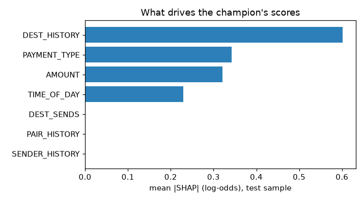
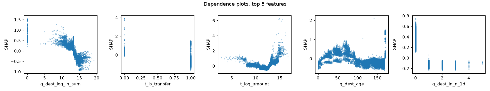

# Explanations: reason codes, stability and quality

Phase 5. Produced by `uv run fgx explain` on the champion `lgbm_g1`. Full output:
`reports/explain/lgbm_g1/report.json`; artifacts the bundle carries:
`artifacts/explain/lgbm_g1/{reason_codes.yaml, explain.json, shap_background.npy}`.

Studied payments are the ones the deployed policy ([conformal.md](conformal.md)) does
**not** simply approve: 45,226 of 377,353 test payments get STEP_UP, REVIEW or BLOCK. Those
are the explanations an analyst or a customer sees. 2,000 of them are used for stability,
500 for the quality metrics.

## Verdict

1. **SHAP explanations are faithful and clearly beat trivial ones.** Faithfulness 0.64 vs
   0.34 for global permutation importance and 0.01 for random; attributions change when the
   model learns nothing (correlation with a label-shuffled model's SHAP: 0.10).
2. **They are stable for most flagged payments.** Across 5 bootstrap refits, the median
   payment keeps the same top-3 reasons (median Jaccard **1.0**, target ≥ 0.8; 75 % of
   payments ≥ 0.8). Background choice for interventional SHAP barely matters (0.98).
3. **The API flags the rest.** `explanation_stable: false` when the 3rd and 4th reasons are
   too close in weight (threshold learned from the refits; balanced accuracy 0.72). It fires
   on 44 % of flagged payments — honest, but a sign that with only four active reason groups,
   the 3rd reason is often a coin toss.
4. **What drives flags is the receiving account's history**, then time of day, amount and
   payment type. Time of day is the simulator-inflated feature from the audit: the reasons
   show it, which makes the artifact visible to an analyst instead of hiding it.
5. **Serving cost is negligible:** reasons come from LightGBM's own TreeSHAP
   (`pred_contrib`), identical to `shap.TreeExplainer` (max difference 0.0), no `shap` in the
   serving image, ~1.5 ms per explained decision through the API.

## Reason codes

Feature attributions (log-odds) are summed per group (`configs/reason_codes.yaml`), and the
top three groups that *raise* the risk become sentences filled with the payment's values:

| Group | Built from | Example text |
|---|---|---|
| DEST_HISTORY | destination novelty, age, payments in, distinct senders | "Receiving account has not received any payment in the last 7 days" |
| AMOUNT | amount, 10M cap | "Amount 544,742 is in a range where fraud is more common" |
| PAYMENT_TYPE | transfer vs cash-out | "TRANSFER payments carry more fraud" |
| TIME_OF_DAY | hour | "Time of day (1:00) raises the risk score for this payment" |
| DEST_SENDS, PAIR_HISTORY, SENDER_HISTORY | receiver pays out; sender→receiver before; sender's own history | (rarely shown: ≈ 0 attribution on PaySim) |

When a payment is held back by the policy rather than by any feature (e.g. the conformal set
is uncertain while every feature lowers the risk), the API states the policy reason instead,
e.g. *"The model is not confident either way, so a check costs less than a mistake"*.

**Design change during the phase:** the first grouping had separate "receiving account is
new" and "receiving account activity" groups. Their reasons said the same thing twice ("got
0 payments in 24 h" and "no payment in 7 days") and, being near-tied, made the top-3
unstable (median Jaccard 0.80, 68 % stable, 58 % flagged unstable). They are now one group;
stability rose to the figures above. A template that claimed "an hour with little normal
traffic" was also replaced: SHAP says the hour raises the score, not why.

## Where attribution goes

| Group | Mean \|SHAP\|, all test payments | Mean SHAP, flagged payments |
|---|---:|---:|
| DEST_HISTORY | 0.602 | +1.011 |
| PAYMENT_TYPE | 0.342 | +0.156 |
| AMOUNT | 0.321 | +0.413 |
| TIME_OF_DAY | 0.229 | +0.570 |
| DEST_SENDS / PAIR_HISTORY / SENDER_HISTORY | 0.000 | 0.000 |

Top five features: `g_dest_log_in_sum`, `t_is_transfer`, `t_log_amount`, `g_dest_age`,
`g_dest_in_n_1d`. 

## Stability (5.2)

| Check | Result |
|---|---|
| Seed / bootstrap (5 refits, same hyper-parameters and tree count) | median top-3 Jaccard **1.000**, mean 0.85, 75.2 % ≥ 0.8; median Kendall τ of group ranks **0.914** |
| Input perturbation (noise 5 % of each feature's std, binary features fixed) | median top-3 Jaccard 1.0, top-3 unchanged for 51 %; median relative attribution change 0.27 for a median margin change 0.43 |
| Background (interventional SHAP, 3 × 1,000 training rows) | median top-3 Jaccard 1.0, mean 0.98 |
| API flag | `explanation_stable = gap(3rd, 4th group) ≥ 0.119`; balanced accuracy 0.72 vs the refit study; flags 44 % |

## Quality vs baselines (5.3)

500 flagged payments; mean with 95 % bootstrap CI.

| Metric | Better | SHAP | Random | Permutation (global) |
|---|---|---|---|---|
| Faithfulness correlation | higher | **0.641** [0.623, 0.657] | 0.010 [−0.012, 0.034] | 0.342 [0.315, 0.370] |
| Model randomisation (corr. with label-shuffled model) | lower | **0.097** [0.072, 0.124] | −0.003 [−0.022, 0.016] | 0.939 [0.939, 0.939] |
| Monotonicity correlation (Quantus) | higher | **0.740** [0.734, 0.745] | 0.002 [−0.015, 0.022] | 0.571 [0.562, 0.580] |
| Max-sensitivity (Quantus) | lower | 0.891 [0.869, 0.914] | 1.643 [1.627, 1.658] | 0.000* |
| Local Lipschitz estimate (Quantus) | lower | 1.396 [1.351, 1.439] | 4.912 [4.848, 4.979] | 0.000* |
| Random logit (Quantus) | lower | −1.000† | −0.011 | −1.000† |

\* Robustness metrics reward constant explanations: a global importance vector never changes,
so it "wins" while saying nothing about the payment. Compare SHAP with random there.
† Trivial for two classes: the other class's attribution is the exact negation.

Random explanations pass the randomisation test (they ignore the model either way) but fail
faithfulness and monotonicity; permutation importance is faithful-ish but identical for the
real and the shuffled model. Only SHAP does well on both.

**Tooling notes.** Quantus 0.6 runs on the LightGBM model through a thin torch wrapper, on
standardised inputs shaped `(n, 1, features)` (the wrapper un-standardises before predicting),
so its noise radii mean the same for every feature. Its `FaithfulnessCorrelation` uses
image-style per-input baselines, which are meaningless for tabular columns with different
units, so faithfulness is computed by our own implementation with training column means as
the baseline; RandomLogit uses Spearman similarity instead of SSIM.
